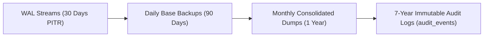

# Backup, Restoration & Key Recovery Policy

> **Operational Scope**: Humanitarian Operations Management Platform (Sovereign Iraqi Infrastructure).  
> **Classification**: Internal Governance & Systems Engineering Standard.  
> **Mandate**: This document defines the backup architectures, retention rules, cryptographic key management, protected copies, recovery objectives (RPO/RTO), and operational ownership for the platform.

---

## 1. Executive Summary & Recovery Objectives

| Metric                             | Target Objective                                               | Implementation Mechanism                                                                                         | Verification Cadence                       |
| :--------------------------------- | :------------------------------------------------------------- | :--------------------------------------------------------------------------------------------------------------- | :----------------------------------------- |
| **Recovery Point Objective (RPO)** | **$\le 5$ Minutes**                                            | Continuous PostgreSQL Write-Ahead Log (WAL) archiving with `archive_timeout = 300s` and streaming replication.   | Daily automated archiver lag monitoring    |
| **Recovery Time Objective (RTO)**  | **$\le 2$ Hours** (Full DB)<br>**$\le 30$ Minutes** (Services) | Containerized stack re-provisioning via pinned Docker manifests and automated base backup restoration.           | Monthly isolated sandbox restore rehearsal |
| **Data Sovereignty Target**        | **100% In-Country**                                            | Primary storage in Baghdad sovereign DC; secondary replica in Erbil sovereign DC. Zero trans-border data export. | Quarterly hosting residency audit          |

---

## 2. Backup Architecture by System Component

```mermaid
flowchart TD
    subgraph Primary_Site["Primary Sovereign Site (Baghdad Tier-III DC)"]
        PG["PostgreSQL 15 Cluster"]
        MinIO["MinIO Private S3 Buckets"]
        SupabaseConf["Supabase & Docker Configurations"]
        Vault["Secret Manager (Vault)"]

        WALArch["Continuous WAL Archiving (5m segments)"]
        BaseDump["Daily Base Backup (pg_basebackup)"]
        S3Repl["MinIO Object Versioning & Mirror"]
        ConfSnap["Git Cryptographic Release Tags"]

        PG --> WALArch
        PG --> BaseDump
        MinIO --> S3Repl
        SupabaseConf --> ConfSnap
    end

    subgraph Secondary_Site["Secondary Sovereign Site (Erbil Tier-III DC)"]
        WORMStorage["Immutable WORM S3 Storage (3-2-1 Copy)"]
        VaultRepl["Vault Encrypted Key Escrow (Shamir)"]

        WALArch -->|Encrypted Wireguard VPN| WORMStorage
        BaseDump -->|Encrypted Wireguard VPN| WORMStorage
        S3Repl -->|Encrypted Wireguard VPN| WORMStorage
        Vault -->|Encrypted Backup| VaultRepl
    end
```



### 2.1 PostgreSQL Database Backups

PostgreSQL is the single source of truth for all operational, financial, and beneficiary records.

1. **Continuous Physical WAL Archiving**:
   - Write-Ahead Logs are compressed and pushed immediately to isolated backup storage using PostgreSQL's `archive_command`:
     ```ini
     archive_mode = on
     archive_command = 'test ! -f /mnt/backups/wal_archive/%f && gzip < %p > /mnt/backups/wal_archive/%f.gz'
     archive_timeout = 300 # Forces segment rotation every 5 minutes
     ```
   - Enables Point-In-Time-Recovery (PITR) to any second within the retention window.
2. **Daily Physical Base Backups (`pg_basebackup`)**:
   - Executed daily at 02:00 UTC during minimum field activity.
   - Generates a full binary copy of the cluster including table spaces and transaction state.
   - Compressed and encrypted with AES-256-GCM.
3. **Daily Logical Dumps (`pg_dump`)**:
   - Executed daily at 03:00 UTC in custom directory format (`-F c`):
     ```bash
     pg_dump -U postgres -d postgres -F c -b -v -f /mnt/backups/logical/humanity_$(date +%Y%m%d_%H%M%S).dump
     ```
   - Serves as an additional layer against logical corruption and enables targeted table-level recovery without restoring the entire cluster.

### 2.2 Supabase & Infrastructure Configuration Backups

1. **Infrastructure as Code (IaC)**:
   - All Docker Compose specifications, Traefik routing rules, and PostgreSQL configuration files are versioned in Git.
   - Releases are tagged with cryptographically signed Git tags (`git tag -s vX.Y.Z`).
2. **Database Schema & Migrations**:
   - Stored in `supabase/migrations/` as sequential, deterministic, transactional SQL scripts.
   - Any schema state can be deterministically reproduced from migration `000001` to current.
3. **Application Configuration**:
   - Environment templates (`.env.staging.example`, `.env.example`) are versioned.
   - Actual operational parameters (excluding secrets) are backed up daily from the host configuration directory (`/srv/humanity-platform/config/`).

### 2.3 Private Storage Backups (MinIO S3 Buckets)

1. **Object Storage Topology**:
   - Contains confidential beneficiary documentation, identification scans, medical reports, and legal attestations.
   - MinIO runs with Server-Side Encryption (SSE-S3) enabled using an isolated KMS key.
2. **Object Versioning & Immutability (WORM)**:
   - Document buckets (`beneficiary-documents`, `export-reports`) have versioning enabled.
   - Retention policy enforces WORM (Write Once, Read Many) with S3 Object Lock for legal compliance: uploaded files cannot be deleted or overwritten for the duration of the retention policy.
3. **Asynchronous Cross-Site Replication**:
   - MinIO bucket replication mirrors newly uploaded encrypted objects across the private WireGuard tunnel to the secondary storage node in Erbil.

### 2.4 Cryptographic Key Recovery & Escrow

Platform security depends on keys that must be recoverable even during total organizational disruption:

| Key Category                     | Storage Location                 | Recovery / Escrow Mechanism                                                                                        | Rotation Cadence            |
| :------------------------------- | :------------------------------- | :----------------------------------------------------------------------------------------------------------------- | :-------------------------- |
| **Vault Master Key**             | HashiCorp Vault / OpenBao        | **Shamir's Secret Sharing (3-of-5 threshold)** split among: Head of Mission, CISO, Head of IT, Legal Counsel, DPO. | Annual or upon role vacancy |
| **PostgreSQL Database Password** | Vault (`secret/humanity/db`)     | Stored in Vault; rotated via database `ALTER ROLE` script.                                                         | 90 Days                     |
| **GoTrue JWT Secret**            | Vault (`secret/humanity/jwt`)    | Stored in Vault; supports dual-key transition overlap (24h grace window).                                          | 90 Days                     |
| **MinIO Root & Service Keys**    | Vault (`secret/humanity/s3`)     | Stored in Vault; mapped via Docker environment secrets.                                                            | 90 Days                     |
| **Storage & Backup GPG Key**     | Hardware Security Module / Vault | Offline cold storage on air-gapped physical USB smart cards stored in mission safes.                               | 2 Years                     |
| **TLS Private Keys**             | Traefik SSL Store                | Auto-renewed via internal ACME / Certificate Authority.                                                            | 90 Days                     |

---

## 3. Retention, Rotation & Protected Copies Policy

### 3.1 Data Retention Schedule

In accordance with humanitarian data protection standards and the Iraqi Legal Framework:



1. **Continuous PITR Window**: **30 Days**. Full WAL logs retained to allow second-by-second rollbacks.
2. **Daily Base Backups**: Retained for **90 Days** on primary backup storage.
3. **Monthly Base Backups**: Retained for **12 Months** in cold storage.
4. **Immutable Audit Events (`audit_events`)**: **7 Years minimum**. Under no circumstances may audit events or financial ledger tables be pruned, dropped, or modified prior to the 7-year mark.
5. **System Diagnostic Logs**: Traefik and PostgREST diagnostic logs rotated every 24 hours and retained for **90 Days**.

### 3.2 3-2-1 Protected Copies Topology

To safeguard against physical disaster, armed conflict, or localized power grid failure in Iraq:

- **3 Copies of Data**:
  1. Live production database volume (Baghdad).
  2. Local on-site backup storage array on separate physical NVMe hardware (Baghdad).
  3. Off-site remote copy in secondary sovereign data center (Erbil).
- **2 Different Media Types**:
  1. High-speed enterprise NVMe storage for primary operations.
  2. Redundant ZFS RAID-Z2 hard disk storage pool for backup archives.
- **1 Copy Off-Site & Immutable**:
  1. Remote replica in Erbil configured with S3 Object Lock in Compliance Mode (cannot be overridden even by the root administrator).

---

## 4. Integrity Checks & Verification

Backups that are not verified are assumed to be non-existent.

1. **Cryptographic Checksums**:
   - Every backup file (`.tar.gz`, `.dump`, `.wal.gz`) generates an adjacent `.sha256` checksum upon creation:
     ```bash
     sha256sum backup_20261113.tar.gz > backup_20261113.tar.gz.sha256
     ```
   - Storage synchronization scripts verify checksums before and after transit.
2. **PostgreSQL Page-Level Checksums (`pg_checksums`)**:
   - Enabled cluster-wide during `initdb` (`-k` flag).
   - Detects bit rot, silent storage degradation, or corrupted disk sectors immediately upon block read.
3. **Automated Catalog Sanity Verification**:
   - Daily automated cron task performs a non-destructive read test against system catalogs:
     ```sql
     SELECT count(*) FROM pg_am;
     SELECT count(*) FROM pg_class;
     ```
4. **Monthly Sandbox Restore Rehearsal**:
   - Documented restore drill executed on the 1st of every month in an air-gapped staging VM to verify RTO and RPO benchmarks.

---

## 5. Access Controls & Secret Hygiene

1. **Principle of Least Privilege**:
   - The backup execution service account (`pg_backup_operator`) possesses only `pg_read_all_data` privileges and has no write or modification permissions.
   - Dedicated backup credentials cannot be used for application transactions.
2. **Air-Gapped Backup Target**:
   - Backup storage servers refuse incoming SSH or PostgREST connections from the application network.
   - Backup pushes use restricted SCP/rsync over dedicated point-to-point WireGuard tunnels with key-based authentication.
3. **Zero Plaintext Secrets**:
   - No database password, encryption passphrase, or access key is stored in backup scripts or environment files.
   - Backup scripts fetch short-lived tokens from Vault using AppRole authentication.

---

## 6. Governance & Ownership Matrix (RACI)

| Operational Role            | Title / Department                        | RACI Status         | Core Responsibilities                                                      |
| :-------------------------- | :---------------------------------------- | :------------------ | :------------------------------------------------------------------------- |
| **Backup Process Owner**    | Head of IT & Infrastructure               | **Accountable (A)** | Overall strategy, SLA adherence, hardware provisioning, budget             |
| **Backup Operations Lead**  | Senior DBA / Site Reliability Engineer    | **Responsible (R)** | Daily verification, WAL monitoring, restore rehearsals, script maintenance |
| **Security & Cryptography** | Chief Information Security Officer (CISO) | **Consulted (C)**   | Vault Shamir key management, cipher review, threat modeling                |
| **Humanitarian Compliance** | Data Protection Officer (DPO)             | **Consulted (C)**   | Retention adherence, legal hold verification, residency compliance         |
| **Field Operations**        | Humanitarian Field Operations Director    | **Informed (I)**    | Maintenance window scheduling, disaster recovery notifications             |

### Emergency Escalation Contacts

- **IT Operations Bridge**: `ops-bridge@humanity.internal.iq` / Secure Radio Channel 4
- **Incident Commander Duty Phone**: Pinned in Mission Headquarters Operations Room
- **DPO Emergency Hotline**: `dpo-emergency@humanity.internal.iq`
