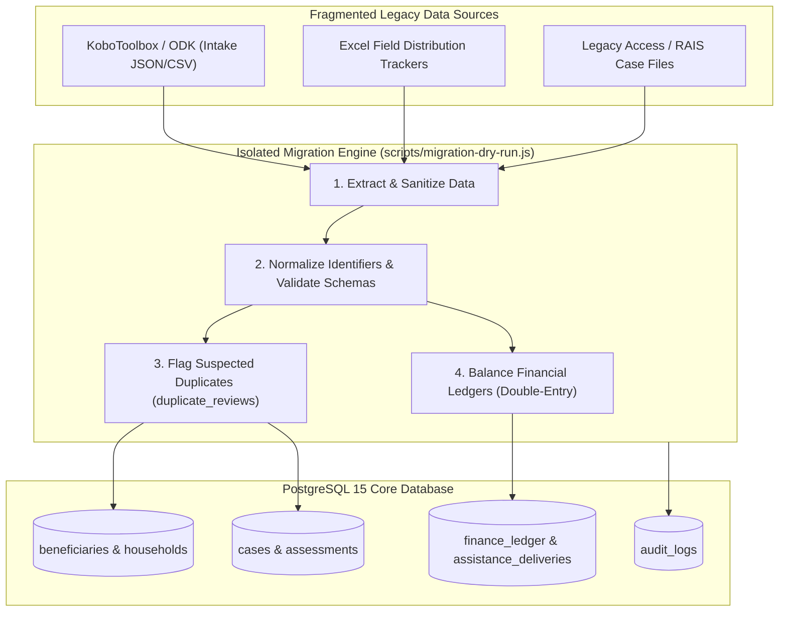

# Data Migration Specification, Reconciliation & Cutover Runbook

> **Target Platform**: Humanitarian Operations Management Platform (PostgreSQL 15)  
> **Legacy Sources**: KoboToolbox / ODK, Excel Distribution Trackers, Legacy RAIS Access DB  
> **Audience**: Data Engineers, Database Administrators, Migration Leads, and Finance Auditors  
> **Strict Notice**: **Do not migrate data or deploy automatically.** This runbook details the end-to-end migration specifications, validation totals, and rollback ownership.

---

## 1. Migration Architecture & Legacy Systems Overview

Historical humanitarian records across Iraq are currently maintained across three fragmented legacy silos:

1. **KoboToolbox / ODK Surveys**: Field intake registrations and vulnerability assessments.
2. **Field Office Excel Spreadsheets**: Emergency cash and food assistance distribution trackers.
3. **Legacy Access DB (RAIS export)**: Case numbers, caseworker assignments, and referral notes.



---

## 2. Field-by-Field Migration Mapping Matrix

### 2.1 Beneficiary Entity Mapping

| Legacy Source Field      | Target Table & Column               | Transformation / Validation Rule                                           |
| :----------------------- | :---------------------------------- | :------------------------------------------------------------------------- |
| `kobo.national_id`       | `beneficiaries.national_id_number`  | Strip whitespace and dashes; normalize to uppercase alphanumeric.          |
| `kobo.id_type`           | `beneficiaries.national_id_type`    | Map to enum: `national_unified_card`, `civil_status_id`, `residence_card`. |
| `kobo.full_name_arabic`  | `beneficiaries.full_name_ar`        | Mandatory; clean Arabic Unicode characters; normalize Hamza/Yaa.           |
| `kobo.full_name_english` | `beneficiaries.full_name_en`        | Trim whitespace; title case. Nullable.                                     |
| `kobo.dob`               | `beneficiaries.date_of_birth`       | Parse ISO-8601 `YYYY-MM-DD`. Reject future dates or age $> 120$ yrs.       |
| `kobo.gender`            | `beneficiaries.gender`              | Standardize: `M`/`1` $\to$ `male`, `F`/`2` $\to$ `female`.                 |
| `kobo.phone`             | `beneficiaries.phone_primary`       | Normalize to Iraqi E.164 format: `+9647XXXXXXXXX`.                         |
| `kobo.gov_code`          | `beneficiaries.governorate_id`      | Validate foreign key in `geo_governorates` (`IQ-BG`, `IQ-NI`, etc.).       |
| `kobo.displacement`      | `beneficiaries.displacement_status` | Map to: `idp`, `returnee`, `refugee`, `host_community`.                    |

### 2.2 Case & Household Mapping

| Legacy Source Field     | Target Table & Column          | Transformation / Validation Rule                                                 |
| :---------------------- | :----------------------------- | :------------------------------------------------------------------------------- |
| `rais.case_id`          | `cases.case_reference`         | Prefixed with programme code: `HUM-2026-[PROG]-[ID]`.                            |
| `kobo.family_id`        | `households.id`                | Group by family ID; set head of household to primary adult.                      |
| `rais.sector`           | `cases.programme_code`         | Map to 8 official codes: `FIN`, `FOD`, `MED`, `HOU`, `EDU`, `EMG`, `EMP`, `SOC`. |
| `rais.status`           | `cases.status`                 | Map: `open` $\to$ `under_assessment`, `closed` $\to$ `closed`.                   |
| `rais.caseworker_email` | `cases.assigned_caseworker_id` | Match against active `staff_profiles.email`. Set null if unassigned.             |

### 2.3 Financial Assistance & Ledger Mapping

| Legacy Source Field | Target Table & Column                  | Transformation / Validation Rule                                          |
| :------------------ | :------------------------------------- | :------------------------------------------------------------------------ |
| `excel.voucher_ref` | `finance_ledger.transaction_reference` | Validate uniqueness across all tranches.                                  |
| `excel.amount_iqd`  | `finance_ledger.amount`                | Must be numeric $> 0$; rounded to 2 decimal places.                       |
| `excel.currency`    | `finance_ledger.currency`              | Strictly `IQD` (or `USD` if approved cross-border grant).                 |
| `excel.prepared_by` | `finance_ledger.maker_id`              | Staff UUID of finance officer who submitted proposal.                     |
| `excel.approved_by` | `finance_ledger.checker_id`            | Staff UUID of finance manager who released payment. **Must != maker_id**. |

---

## 3. Deduplication & Human Duplicate Review Protocol

> [!WARNING]
> **Strict Prohibition: Never Automatically Merge Suspected Duplicates**  
> In conflict and displacement contexts, individuals frequently share identical tribal names or have mistyped national ID digits. Silently merging records risks depriving genuine beneficiaries of aid or uniting hostile estranged households.

### The Adjudication Workflow:

1. **Detection Rule**:
   - Exact match on `national_id_number` OR
   - Trigram similarity $\ge 0.85$ on `full_name_ar` within the same governorate.
2. **Staging Action**:
   - Both beneficiary records are inserted into `beneficiaries`.
   - The secondary record is marked with `duplicate_status = 'pending_review'`.
   - A link entry is created in `duplicate_reviews`:
     ```sql
     INSERT INTO duplicate_reviews (target_beneficiary_id, matched_beneficiary_id, match_score, match_reasons, status)
     VALUES ('<ID_A>', '<ID_B>', 0.92, '{"matched_fields": ["national_id", "governorate"]}'::jsonb, 'pending');
     ```
3. **Human Review Requirement**:
   - A casework supervisor must inspect the physical documents and record an explicit decision in `duplicate_reviews` (`confirmed_duplicate`, `false_positive`, `merged_manual`).
   - The decision requires mandatory written justification notes ($\ge 10$ characters).

---

## 4. Financial Reconciliation & Validation Totals

Before, during, and after migration, the financial ledger must balance to $0.00$ IQD variance against bank disbursement reports.

### Pre-Cutover Validation Checks:

```sql
-- 1. Verify Zero Self-Approvals in Legacy Financial Data
SELECT count(*) FROM legacy_disbursements WHERE maker_email = checker_email;
-- Must return 0. If > 0, manual checker re-assignment is required prior to ingestion.

-- 2. Calculate Total Legacy Disbursement Value
SELECT SUM(disbursed_amount) AS total_legacy_iqd FROM legacy_disbursements;

-- 3. Calculate Target Database Ledger Balance Post-Migration
SELECT SUM(amount) AS total_restored_iqd FROM finance_ledger WHERE transaction_type = 'disbursement';
```

**Acceptance Criterion**: `total_legacy_iqd == total_restored_iqd` (Variance $= 0.00$ IQD).

---

## 5. Cutover Window Timeline & Runbook

The migration is executed during an authorized 12-hour operational window (Friday 20:00 UTC to Saturday 08:00 UTC):

| Time (UTC)  | Phase            | Actions Performed                                                           | Owner                  |
| :---------- | :--------------- | :-------------------------------------------------------------------------- | :--------------------- |
| **T-02:00** | Pre-Flight       | Confirm RFC change ticket approval; verify on-call team attendance.         | Release Coordinator    |
| **T-00:00** | System Freeze    | Set legacy Kobo and RAIS systems to **Read-Only Mode**. Notify field desks. | Systems Administrator  |
| **T+00:30** | Source Hash      | Extract final legacy dumps; compute and log SHA-256 cryptographic hashes.   | Data Engineer          |
| **T+01:00** | DB Snapshot      | Execute pre-migration PostgreSQL backup snapshot (`pre_mig_backup.dump`).   | Senior DBA             |
| **T+01:30** | Ingestion        | Execute automated ETL pipeline in transactional batches of 1,000 records.   | Data Migration Lead    |
| **T+04:30** | Integrity Checks | Run row count, foreign key, duplicate review, and financial total checks.   | Quality Assurance Lead |
| **T+05:30** | Sign-Off Gate    | Executive review of reconciliation totals. Formal Go/No-Go decision.        | Finance Director & DPO |
| **T+06:00** | Cutover          | Point Traefik DNS to new production endpoints; enable field staff access.   | SRE Lead               |
| **T+08:00** | Standby          | Active monitoring of incoming API requests and staff login activity.        | Tier 2 Support         |

---

## 6. Rollback & Forward-Fix Strategy

### 6.1 Abort & Rollback Triggers

The Migration Lead must abort the migration and initiate immediate rollback if:

1. Financial balance discrepancy exceeds **$0.00$ IQD**.
2. Unhandled constraint failure or corrupted data blocks $> 0.1\%$ of records.
3. Total migration elapsed time exceeds **T+6 hours** without reaching the Sign-Off Gate.

### 6.2 Rollback Execution Steps:

1. Stop the migration ETL runner script immediately (`kill -9`).
2. Terminate PostgREST and Web containers:
   ```bash
   docker compose -f infra/docker-compose.staging.yml stop web kong postgrest
   ```
3. Restore clean pre-migration database snapshot:
   ```bash
   docker compose -f infra/docker-compose.staging.yml exec -T supabase-db \
     pg_restore -U postgres -d postgres --clean --if-exists /var/lib/postgresql/backups/pre_mig_backup.dump
   ```
4. Lift Read-Only mode on legacy systems to allow field operations to resume.
5. Broadcast notification to all field offices: _"Migration aborted due to reconciliation variance; legacy systems remain active."_

### 6.3 Forward-Fix Procedure:

For minor mapping anomalies (e.g. invalid phone number formatting on 5 records):

- Anomalous rows are routed to a temporary `migration_quarantine` table with the rejection reason.
- Clean records continue ingestion without aborting the batch.
- A forward-fix SQL patch is authored and reviewed by the DBA within 24 hours.

---

## 7. Migration Governance & Ownership (RACI)

| Role                     | Name & Title                                    | RACI Status         | Core Responsibilities                                           |
| :----------------------- | :---------------------------------------------- | :------------------ | :-------------------------------------------------------------- |
| **Migration Lead**       | **Hussein Al-Qaisi** (Data Systems Architect)   | **Accountable (A)** | ETL pipeline development, schema validation, cutover execution  |
| **Database Lead**        | **Tariq Al-Jubouri** (Senior SRE / DBA)         | **Responsible (R)** | Database snapshots, WAL archiving, performance tuning, rollback |
| **Financial Reconciler** | **Mona Karim** (Senior Finance Officer)         | **Responsible (R)** | Pre/post balance sheet reconciliation, ledger totals sign-off   |
| **Protection Officer**   | **Fatima Al-Khafaji** (Data Protection Officer) | **Consulted (C)**   | Duplicate review oversight, informed consent audit, DPIA        |
| **Field Coordinator**    | **Ahmed Al-Bayati** (Field Support Lead)        | **Informed (I)**    | Field office notification, read-only window coordination        |
