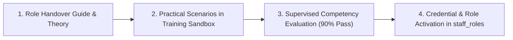

# Operational Handover & Role-Specific Training Framework

> **Scope**: Standardized Operational Handover & Field Training Curriculum.  
> **Audience**: Systems Operators, Security Administrators, Caseworkers, Finance Staff, and Compliance Auditors.  
> **Mandate**: Ensure operational autonomy, zero single-points-of-knowledge, adherence to humanitarian standards, and certified competence prior to live production access.

---

## 1. Handover Framework & Training Methodology

Prior to granting production access or issuing hardware to any staff member, the organization mandates completion of role-specific training modules followed by a supervised practical drill in the training sandbox (`training.humanity.internal.iq`).

---

## 2. Role-Specific Handover Directory

| Handover Guide                                                                                      | Target Roles                               | Core Operational Competencies                                                                                                                                           |
| :-------------------------------------------------------------------------------------------------- | :----------------------------------------- | :---------------------------------------------------------------------------------------------------------------------------------------------------------------------- |
| [operators.md](file:///c:/Users/MSI/Desktop/MANAGE/docs/operations/handover/operators.md)           | Systems Operators, SREs, DBAs              | Container stack lifecycle, Traefik reverse proxy, PostgreSQL continuous WAL archiving, MinIO S3 management, monitoring probes, backup restoration drills.               |
| [administrators.md](file:///c:/Users/MSI/Desktop/MANAGE/docs/operations/handover/administrators.md) | Security Admins, IT Operations Leads       | Role-based access control (`staff_roles`), geographic/programme scoping, credential revocation, audit forensics, remote device wipe.                                    |
| [caseworkers.md](file:///c:/Users/MSI/Desktop/MANAGE/docs/operations/handover/caseworkers.md)       | Field Caseworkers, Intake Officers         | Arabic RTL interface navigation, informed consent capture, duplicate candidate review, assessment scoring, offline mobile draft management, sync conflict resolution.   |
| [finance_staff.md](file:///c:/Users/MSI/Desktop/MANAGE/docs/operations/handover/finance_staff.md)   | Finance Makers, Finance Checkers, Cashiers | Maker-checker dual authorization, payment proposal generation, release authorization, approval limits, ledger immutability, compensating reversal accounting (ADR-004). |
| [auditors.md](file:///c:/Users/MSI/Desktop/MANAGE/docs/operations/handover/auditors.md)             | Compliance Auditors, DPOs, Inspectors      | Immutable audit trail querying (`audit_logs`), export event tracking, k-anonymity verification ($< 5$ cell suppression), data minimization oversight.                   |

---

## 3. Training & Certification SLA

1. **Mandatory Attendance**: All 120 operational staff must complete their designated module during Stage 3 of the rollout.
2. **Re-Certification Cadence**: Staff must undergo annual refresher training or immediate re-training following any SEV-1 security incident.
3. **Audit Ledger Verification**: Every role activation in `staff_roles` requires a corresponding training completion certificate reference in the audit rationale.
