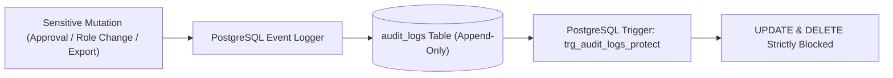

# Operational Handover Guide: Auditors, Compliance Officers & Data Protection Officers

> **Target Roles**: Internal Auditors, External Donor Auditors, Data Protection Officers (DPO), Humanitarian Safeguarding Inspectors.  
> **Key Responsibilities**: Immutable audit trail verification, export monitoring, k-anonymity compliance checks, access justification reviews, and regulatory reporting.

---

## 1. Audit Trail Architecture & Immutability

The platform records an unalterable, chronological log of all sensitive operations in the `audit_logs` table:



### Critical Security Protections:

1. **Append-Only Enforcement**: Database trigger `trg_audit_logs_protect` permanently rejects any `UPDATE` or `DELETE` against `audit_logs`.
2. **7-Year Retention Mandate**: Audit events are retained for a minimum of 7 years in accordance with humanitarian accountability frameworks.
3. **Zero Privilege Bypass**: Even the database superuser role is procedurally and cryptographically prohibited from altering the audit log.

---

## 2. Querying the Audit Trail & Standard Investigations

Auditors access the system via the dedicated **سجل التدقيق والمراقبة (Audit & Monitoring Log)** portal or via read-only SQL queries on the isolated replica.

### 2.1 Investigating Sensitive Record Access

Query which staff members accessed a specific beneficiary record and inspect their recorded access justification:

```sql
SELECT
  occurred_at,
  actor_id,
  actor_role,
  action_name,
  details->>'access_reason' AS access_reason,
  ip_address
FROM audit_logs
WHERE entity_table = 'beneficiaries'
  AND entity_id = '<BENEFICIARY_UUID>'
ORDER BY occurred_at DESC;
```

### 2.2 Auditing Financial Dual Authorization

Verify that every approved assistance delivery was reviewed by distinct individuals:

```sql
SELECT
  id,
  transaction_reference,
  amount,
  maker_id,
  checker_id,
  CASE WHEN maker_id = checker_id THEN 'VIOLATION' ELSE 'COMPLIANT' END AS compliance_status
FROM finance_ledger;
-- Must return 0 violations.
```

### 2.3 Monitoring Report Exports & K-Anonymity

Ensure that no caseworker or manager exported raw identifiable beneficiary lists:

```sql
SELECT
  occurred_at,
  actor_id,
  details->>'report_type' AS report_type,
  details->>'format' AS format,
  details->>'row_count' AS row_count,
  details->>'filters' AS filters
FROM audit_logs
WHERE action_name = 'report_exported'
ORDER BY occurred_at DESC;
```

---

## 3. Data Protection & K-Anonymity Compliance Checks

Under the organization's humanitarian data protection policy:

- **Small-Group Suppression**: Any operational breakdown reporting fewer than $5$ individuals ($k < 5$) must be suppressed from display and export to prevent re-identification of vulnerable individuals.
- **Legal Hold Inspections**: Verify cases marked with `legal_hold = true` are protected from routine data archival or disposal.
- **Incident Escalation**: If an unauthorized bulk export is discovered, trigger the [Accidental/Unauthorized Export Runbook](file:///c:/Users/MSI/Desktop/MANAGE/docs/operations/incident_response/accidental_export.md) immediately.

---

## 4. Auditor Certification Sign-Off

At the conclusion of each periodic audit:

1. Generate the audit summary report.
2. Sign the **Humanitarian Compliance & Privacy Certificate**.
3. File the record in the organization's confidential compliance vault.
