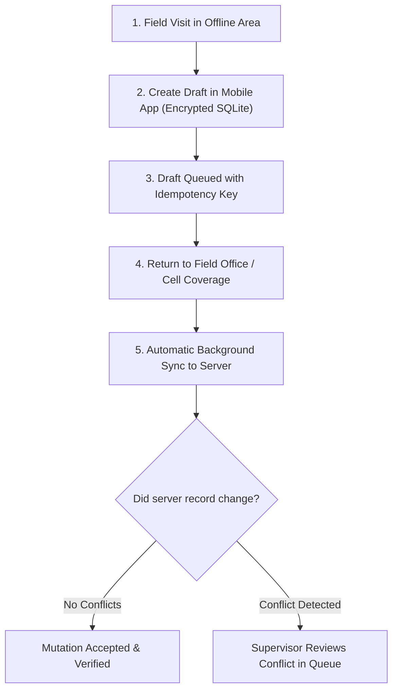

# Operational Handover Guide: Field Caseworkers & Intake Officers

> **Target Roles**: Field Caseworkers, Intake Officers, Vulnerability Assessors, Field Supervisors.  
> **Key Responsibilities**: Beneficiary registration, explicit informed consent capture, duplicate candidate review, assessment scoring, case follow-up, and mobile offline operations.

---

## 1. Core Operating Principles for Field Staff

1. **Arabic RTL First**: The web and mobile portals load in Arabic by default with complete right-to-left layout alignment.
2. **Explicit Informed Consent**: Before entering personal information, you must explain the purpose of data collection to the head of household or guardian and record their explicit informed consent.
3. **Never Auto-Merge Duplicates**: If the system alerts you that a beneficiary may already be registered, **do not attempt to merge or delete either record**. Flag the case for supervisor review.
4. **Data Minimization ("Do No Harm")**: Never record extraneous personal notes regarding sectarian affiliation, political views, or armed actor relations.

---

## 2. Standard Field Workflows

### 2.1 Beneficiary Registration Workflow

1. Navigate to **المستفيدون (Beneficiaries)** $\to$ **تسجيل مستفيد جديد (Register New Beneficiary)**.
2. Enter the official National Unified Card number (`الرقم الوطني الموحد`) or Civil Status ID.
3. Enter the full Arabic name matching official documentation (`الاسم الكامل بالعربية`).
4. Record primary contact phone number (`+9647XXXXXXXXX`).
5. Select displacement status (`نازح / عائد / مجتمع مضيف`).
6. Confirm **الموافقة المستنيرة الصريحة (Explicit Informed Consent)**. Submit registration.

### 2.2 Handling Potential Duplicate Alerts

If an identical national ID or similar tribal name exists:

- The system will stage the registration with status `قيد التدقيق (Pending Review)`.
- Submit the registration with explanatory notes (`ملاحظات التدقيق`).
- Inform your Field Supervisor to access the **تدقيق الازدواجية (Duplicate Reviews)** queue to review both records side-by-side.

### 2.3 Conducting Programme Assessments

1. Open the assigned beneficiary case.
2. Click **إجراء تقييم جديد (Conduct Assessment)**.
3. Select the appropriate humanitarian programme:
   - `FIN` (مساعدات نقدية / Financial Assistance)
   - `FOD` (أمن غذائي / Food Security)
   - `MED` (رعاية صحية / Medical Services)
   - `HOU` (مأوى وإسكان / Housing & Shelter)
   - `EDU` (تعليم وتدريب / Education)
   - `EMG` (إغاثة طارئة / Emergency Relief)
   - `EMP` (سبل العيش / Livelihoods & Employment)
   - `SOC` (حماية ورعاية اجتماعية / Social Protection)
4. Complete the weighted scoring criteria and submit for supervisor approval.

---

## 3. Mobile Offline Operations & Synchronization

When conducting field visits in remote or internet-restricted areas of Iraq:

### Key Field Rules for Offline Work:

- **Local Database Encryption**: All offline data is encrypted with SQLCipher on the device.
- **24-Hour Timeout**: Your offline session will automatically expire after 24 hours of inactivity. Ensure you sync before logging out.
- **Prohibited Offline Actions**: You **cannot approve eligibility or release financial payments offline**. These actions require live server-side validation.
- **Handling Sync Conflicts**: If another caseworker edited the same case while you were offline, the app will flag a **Sync Conflict**. Do not panic; your draft is safely preserved in the conflict queue for supervisor review.

---

## 4. Emergency Field Support

- **Field Helpdesk**: WhatsApp Field Hotline: `+964 770 000 0111` / Radio Channel 2.
- **Lost Hardware Emergency**: If your phone or tablet is lost, stolen, or confiscated at a checkpoint, immediately notify your supervisor or call the Security Duty Officer to initiate a remote wipe. Follow [docs/operations/incident_response/lost_device.md](file:///c:/Users/MSI/Desktop/MANAGE/docs/operations/incident_response/lost_device.md).
