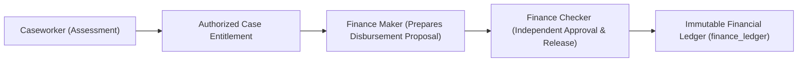

# Operational Handover Guide: Finance Staff & Cash Transfer Officers

> **Target Roles**: Finance Makers (Officers), Finance Checkers (Managers), Cashier Agents.  
> **Key Responsibilities**: Financial assistance proposal creation, maker-checker dual authorization, ledger immutability enforcement, compensating reversals, and reconciliation.

---

## 1. Core Financial Controls & Dual Authorization

To protect donor funds and comply with anti-fraud regulations, the platform enforces strict structural separation between transaction creation and transaction approval:



### The Inviolable Financial Guardrails:

1. **Maker-Checker Separation**: A staff member who creates a payment proposal (`maker_id`) can **never** approve or release it (`checker_id`). Self-approval is rejected by the database engine.
2. **Approval Ceilings**:
   - Field Finance Officer (Maker): Prepares proposals up to authorized project limits.
   - Sub-Office Finance Manager (Checker Tier 1): Approves disbursements up to **$5,000,000$ IQD**.
   - Country Finance Director (Checker Tier 2): Approves disbursements exceeding **$5,000,000$ IQD**.
3. **Ledger Immutability**: The financial ledger (`finance_ledger`) is strictly append-only. **Direct `UPDATE` or `DELETE` operations are blocked by PostgreSQL database triggers**.
4. **Zero Cash Payments in System**: The platform records entitlements, payment orders, and distribution receipts. It does not store credit card details or connect directly to bank APIs.

---

## 2. Standard Financial Operating Procedures

### 2.1 Preparing a Payment Proposal (Finance Maker Workflow)

1. Log in with the `finance_maker` role.
2. Navigate to **المالية والمدفوعات (Finance & Disbursements)** $\to$ **طلبات الصرف (Disbursement Queue)**.
3. Select an authorized assistance entitlement associated with an approved case.
4. Verify the beneficiary's national ID number and authorized amount.
5. Enter the unique transaction reference code (e.g., `TX-2026-FOD-0412`).
6. Enter operational rationale notes ($\ge 10$ characters).
7. Submit the proposal. The entitlement transitions to `pending_approval`.

### 2.2 Approving a Payment Order (Finance Checker Workflow)

1. Log in with the `finance_checker` role.
2. Navigate to **الموافقات المالية (Financial Approvals)**.
3. Review the pending payment proposal:
   - Verify supporting documentation and eligibility assessment.
   - Confirm that the proposal was prepared by an independent Maker.
4. Click **موافقة وإطلاق الصرف (Approve & Release)**.
5. The system records the transaction in `finance_ledger` and updates the entitlement to `disbursed`.

---

## 3. Corrective Accounting & Compensating Reversals (ADR-004)

If an erroneous disbursement or misallocation occurs:

> [!CAUTION]
> **Never Attempt to Delete or Modify a Posted Transaction**  
> Any database administrator or finance user attempting an `UPDATE` or `DELETE` on `finance_ledger` will receive an immediate `ERR_LEDGER_IMMUTABLE` exception.

### Reversal Procedure:

1. Locate the erroneous transaction reference in the ledger.
2. Click **إجراء قيد تسوية عكسي (Issue Compensating Reversal)**.
3. Enter the mandatory audit justification explaining the error (e.g., _"Duplicate payment issued due to cash-out agent network error"_).
4. The system posts an equal and opposite entry in `finance_ledger` referencing `reversal_of_transaction_id`:
   ```sql
   INSERT INTO finance_ledger (
     entitlement_id, transaction_type, transaction_reference, amount, currency,
     maker_id, checker_id, reversal_of_transaction_id, rationale
   ) VALUES (
     '<ENTITLEMENT_UUID>', 'reversal', 'REV-TX-2026-0412', 250000.00, 'IQD',
     '<MAKER_UUID>', '<CHECKER_UUID>', '<ORIGINAL_TX_UUID>', 'Corrective reversal authorized by Finance Director'
   );
   ```
5. Net financial balance returns to zero without altering historical transaction history.

---

## 4. Daily Reconciliation Checklist

At the end of each operational day, the Finance Checker must execute the reconciliation report:

1. Export the daily ledger summary: `SELECT SUM(amount) FROM finance_ledger WHERE transaction_type = 'disbursement' AND posted_at >= CURRENT_DATE;`.
2. Compare against physical cash distribution manifests or Hawala/ZainCash agent statement receipts.
3. Variance must equal **$0.00$ IQD**.
4. Upload the signed reconciliation certificate to the private finance document store.
