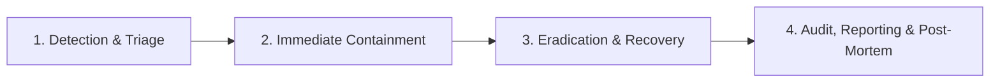

# Incident Response Framework & Operating Procedures

> **Scope**: Security, operational, and data privacy incidents across web and mobile platforms.  
> **Audience**: All Humanitarian Staff, Security Officers, System Administrators, Incident Commanders, and Data Protection Officers (DPO).  
> **Mandate**: Ensure immediate containment, rapid recovery, strict adherence to the "Do No Harm" principle, and compliance with the 72-hour regulatory notification requirement.

---

## 1. Incident Severity Classification

| Severity Level       | Definition                                                                                                                              | Response SLA         | Leadership Notification                               |
| :------------------- | :-------------------------------------------------------------------------------------------------------------------------------------- | :------------------- | :---------------------------------------------------- |
| **SEV-1 (Critical)** | Active data breach, ransomware infection, physical loss of unencrypted device with PII, or total platform outage halting emergency aid. | **$\le 15$ Minutes** | Head of Mission, CISO, DPO, Legal Counsel immediately |
| **SEV-2 (High)**     | Single staff account compromised, accidental report export sent outside perimeter, or maker-checker authorization failure.              | **$\le 30$ Minutes** | CISO, DPO, IT Operations Lead                         |
| **SEV-3 (Moderate)** | Non-critical service degradation (e.g., slow reporting), intermittent mobile sync errors, or failed brute force login attempt.          | **$\le 2$ Hours**    | SRE / DBA Lead, IT Service Desk                       |
| **SEV-4 (Low)**      | Minor UI inconsistency, localized localization glitch, or non-security operational bug.                                                 | **$\le 24$ Hours**   | Development Team                                      |

---

## 2. Standard Incident Lifecycle

1. **Detection & Triage**: Identify incident, classify severity (SEV-1 to SEV-4), and appoint an Incident Commander.
2. **Immediate Containment**: Execute isolated containment runbook immediately (e.g., remote session revoke, network isolation).
3. **Eradication & Recovery**: Remove threat vectors, restore uncorrupted data, verify integrity.
4. **Audit, Reporting & Post-Mortem**: Log incident evidence, deliver regulatory notification within 72 hours if PII is impacted, and conduct a blameless post-mortem within 48 hours.

---

## 3. Incident Runbooks Directory

The following specialized operational runbooks govern specific incident categories:

| Runbook                                                                                                              | Scenario                                                   | Core Containment Action                                                                |
| :------------------------------------------------------------------------------------------------------------------- | :--------------------------------------------------------- | :------------------------------------------------------------------------------------- |
| [lost_device.md](file:///c:/Users/MSI/Desktop/MANAGE/docs/operations/incident_response/lost_device.md)               | Field smartphone / tablet lost, stolen, or seized          | Remote GoTrue session revocation, local encrypted database wipe, token invalidation.   |
| [account_compromise.md](file:///c:/Users/MSI/Desktop/MANAGE/docs/operations/incident_response/account_compromise.md) | Staff credentials phished, leaked, or credential stuffed   | Immediate account lock, password/MFA reset, audit log query for exfiltration window.   |
| [accidental_export.md](file:///c:/Users/MSI/Desktop/MANAGE/docs/operations/incident_response/accidental_export.md)   | Beneficiary list or PII exported to unauthorized location  | Immediate recall/deletion protocol, k-anonymity assessment, DPO notification.          |
| [suspected_breach.md](file:///c:/Users/MSI/Desktop/MANAGE/docs/operations/incident_response/suspected_breach.md)     | Anomalous database queries or server intrusion suspected   | Network boundary isolation, forensic memory snapshot, read-only lock.                  |
| [ransomware.md](file:///c:/Users/MSI/Desktop/MANAGE/docs/operations/incident_response/ransomware.md)                 | Host infected or ransomware attempt detected               | Immediate network quarantine, rebuild from pinned images, restore from immutable WORM. |
| [service_outage.md](file:///c:/Users/MSI/Desktop/MANAGE/docs/operations/incident_response/service_outage.md)         | National internet blackout, power loss, or container death | Offline mobile queue continuity, VSAT backhaul failover, auto-restart.                 |

---

## 4. Emergency Contacts & Reporting Channels

- **Incident Commander Bridge**: `incident@humanity.internal.iq`
- **Data Protection Officer (DPO)**: `dpo@humanity.internal.iq`
- **Security Operations Center (SOC)**: `soc@humanity.internal.iq`
