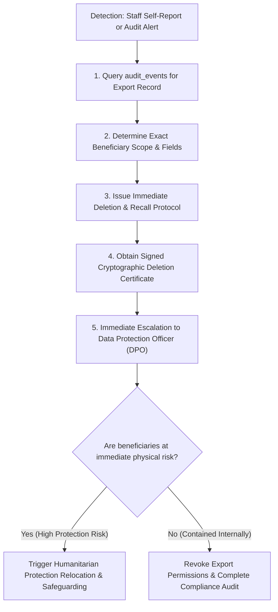

# Incident Runbook: Accidental or Unauthorized Data Export

> **Incident Type**: Data Leakage / Humanitarian PII Exposure / Policy Breach  
> **Severity**: SEV-2 (Contained within staff device) | SEV-1 (Transmitted to external recipient / public network)  
> **Response SLA**: **$\le 15$ Minutes** from report or audit alert

---

## 1. Scenario Context & Humanitarian Protection Risks

In humanitarian field operations in Iraq, beneficiary lists often contain sensitive information concerning internally displaced persons (IDPs), returnees, female-headed households, and vulnerable minority groups.

> [!CAUTION]
> **Severe Protection Hazard ("Do No Harm")**: Exposure of beneficiary identities, national ID numbers, or shelter locations creates acute physical security risks, extortion threats, or detention hazards for vulnerable populations. Unauthorized distribution of operational lists is treated as a critical protection failure.

---

## 2. Immediate Containment Procedure (Execute Within 15 Minutes)



### Step 2.1: Locate the Export Record in the Audit Ledger

Every export operation in the platform is tracked in `audit_events` with the exact filters and row counts:

```sql
SELECT
  id,
  created_at,
  actor_id,
  action,
  details->>'report_type' AS report_type,
  details->>'format' AS format,
  details->>'row_count' AS row_count,
  details->>'filters' AS filters,
  ip_address
FROM audit_events
WHERE action = 'report_exported'
  AND created_at >= NOW() - INTERVAL '24 hours'
ORDER BY created_at DESC;
```

### Step 2.2: Isolate the Exporting Staff Member

1. Contact the staff member via secure voice/radio.
2. Instruct them to immediately disconnect the receiving workstation from Wi-Fi/Ethernet to prevent cloud synchronization (e.g., OneDrive, Google Drive, Dropbox).
3. If transmitted via email, verify whether the recipient mail server is internal or external:
   - **Internal Server**: Execute exchange server administrative purge (`Search-Mailbox -DeleteContent`).
   - **External Server**: Contact receiving organization's security team immediately to enforce destruction.

### Step 2.3: Secure Hardware & Execute Secure Deletion

1. Dispatch IT support to the staff member's workstation.
2. Inspect the `Downloads`, `Temp`, and browser cache folders.
3. Perform cryptographic shredding of the exported file:
   ```bash
   # Linux / macOS:
   shred -u -z -n 5 /path/to/exported_beneficiary_list.csv

   # Windows PowerShell:
   sdelete -p 5 C:\Users\<Username>\Downloads\exported_beneficiary_list.csv
   ```
4. Empty system trash and verify browser download history is cleared.
5. Have the staff member and their supervisor sign an **Affidavit of Digital Destruction**.

---

## 3. Data Protection Impact Assessment (DPIA)

Within 2 hours of containment, the Incident Commander and DPO must complete the impact checklist:

- [ ] **K-Anonymity Assessment**: Was the export aggregated with cell suppression ($k \ge 5$) or did it contain unmasked individual identities?
- [ ] **Identifier Sensitivity**: Did the export include `national_id_number`, biometric references, phone numbers, or exact residential addresses?
- [ ] **Programme Vulnerability**: Did the export involve medical cases (`MED`), child protection, or gender-based violence (`SOC`) assistance records?
- [ ] **External Reach**: Did the file touch any third-party cloud storage or unencrypted public transit?

---

## 4. Remediation & Policy Hardening

1. **Temporary Revocation of Export Privileges**:
   ```sql
   UPDATE staff_roles
   SET is_active = false
   WHERE staff_id = '<EXPORTER_STAFF_UUID>' AND role = 'manager';
   ```
2. **Review K-Anonymity & Masking Thresholds**:
   Verify that web export utilities continue to enforce cell suppression for small-group breakdowns ($< 5$).
3. **Mandatory Refresher Training**: The staff member must complete the mandatory "Humanitarian Data Responsibility & Safeguarding" module prior to role reinstatement.
4. **Regulatory Reporting**: If required under donor or UN cluster data protection frameworks, file the formal breach notification within 72 hours.
