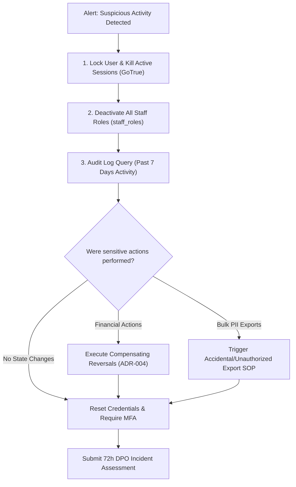

# Incident Runbook: Account Compromise & Unauthorized Credential Access

> **Incident Type**: Identity Theft / Credential Leak / Phishing / Session Hijack  
> **Severity**: SEV-2 (Standard Staff) | SEV-1 (Finance Checker, Manager, or Admin)  
> **Response SLA**: **$\le 15$ Minutes** from detection

---

## 1. Trigger Symptoms & Detection Vectors

An account compromise is suspected or confirmed when:

- Multiple failed login alerts followed by successful authentication from an unknown IP or geolocation.
- Simultaneous logins detected for a single user ID from geographically distant locations.
- Field staff reports unexpected password change notifications or phishing submission.
- Anomalous, high-velocity record queries observed in Traefik / PostgREST logs.
- Unauthorized state change attempts flagged by the server-side authorization matrix.

---

## 2. Immediate Containment Procedure (Execute Within 15 Minutes)



### Step 2.1: Terminate All Active Sessions & Lock Account

Execute via containerized psql session on the database host:

```bash
docker compose -f infra/docker-compose.staging.yml exec -T supabase-db \
  psql -U postgres -d postgres -c "
    -- Invalidate all JWT refresh tokens immediately
    DELETE FROM auth.refresh_tokens WHERE user_id = '<COMPROMISED_USER_UUID>';

    -- Ban the user indefinitely pending investigation
    UPDATE auth.users
    SET banned_until = 'infinity',
        raw_app_meta_data = raw_app_meta_data || '{\"account_locked\": true, \"lock_reason\": \"Security compromise investigation\"}'::jsonb
    WHERE id = '<COMPROMISED_USER_UUID>';"
```

### Step 2.2: Deactivate Staff Role Assignments

Ensure any cached permissions or API tokens cannot execute server-side functions:

```bash
docker compose -f infra/docker-compose.staging.yml exec -T supabase-db \
  psql -U postgres -d postgres -c "
    UPDATE staff_roles
    SET is_active = false
    WHERE staff_id = '<COMPROMISED_USER_UUID>';

    INSERT INTO audit_events (action, actor_id, entity_type, entity_id, details)
    VALUES (
      'staff_account_locked_emergency',
      '<INCIDENT_COMMANDER_UUID>',
      'staff',
      '<COMPROMISED_USER_UUID>',
      '{\"incident_ticket\": \"INC-202611-01\", \"reason\": \"Suspected credential compromise\"}'::jsonb
    );"
```

---

## 3. Forensic Impact Assessment

The Incident Commander and Security Lead must query the full audit trail for the compromised identity across the suspected compromise window:

### Step 3.1: Query Activity Timeline

```sql
SELECT
  id,
  created_at,
  action,
  entity_type,
  entity_id,
  ip_address,
  user_agent,
  details
FROM audit_events
WHERE actor_id = '<COMPROMISED_USER_UUID>'
  AND created_at >= NOW() - INTERVAL '7 days'
ORDER BY created_at DESC;
```

### Step 3.2: Inspect Sensitive Workflow Mutations

1. **Financial Actions**: Check if the actor initiated or approved any assistance disbursements:
   ```sql
   SELECT id, programme_code, amount, status, maker_id, checker_id, updated_at
   FROM assistance_deliveries
   WHERE maker_id = '<COMPROMISED_USER_UUID>' OR checker_id = '<COMPROMISED_USER_UUID>';
   ```
   - _Remediation_: If unauthorized disbursements were approved, initiate **Compensating Reversal Accounting** under ADR-004. Never delete the posted ledger records.
2. **Case Modifications**: Verify whether case statuses were altered or unauthorized notes submitted.
3. **Data Exfiltration**: Check for report export actions:
   ```sql
   SELECT * FROM audit_events
   WHERE actor_id = '<COMPROMISED_USER_UUID>'
     AND action IN ('export_report', 'bulk_query_beneficiaries');
   ```

---

## 4. Remediation & Account Reinstatement

1. **Verify Staff Identity**: Conduct an out-of-band video or in-person verification with the affected staff member and their supervisor.
2. **Mandatory Password & MFA Reset**:
   - Issue an administratively forced password reset link.
   - Re-enroll multi-factor authentication (TOTP/hardware key).
3. **Lift Account Lock**:
   ```sql
   UPDATE auth.users SET banned_until = NULL WHERE id = '<COMPROMISED_USER_UUID>';
   ```
4. **Re-assign Authorized Roles**: Re-activate roles in `staff_roles` with a documented audit rationale.
5. **DPO Compliance Assessment**: Deliver formal breach evaluation to the Data Protection Officer within 72 hours.
