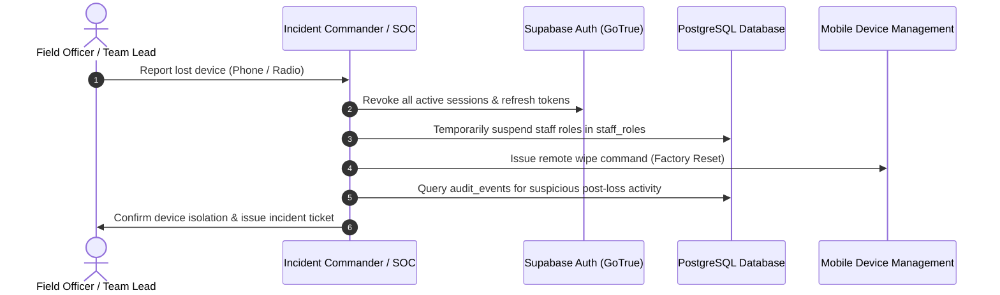

# Incident Runbook: Lost, Stolen, or Confiscated Mobile Device

> **Incident Type**: Physical Hardware Loss / Field Security Event  
> **Severity**: SEV-2 (Default) | SEV-1 (If device belonged to Security Admin or unencrypted)  
> **Response SLA**: **$\le 15$ Minutes** from report receipt

---

## 1. Scenario Context & Threat Assessment

Field staff operate mobile devices (smartphones, tablets) in high-risk operational environments across Iraq (e.g., Ninawa, Anbar, Basra). Devices may be lost, stolen, or confiscated at checkpoints.

### Inherent Platform Safeguards (Defense-in-Depth):

1. **Encrypted Local Storage**: Under ADR-003, local SQLite databases are encrypted at rest with SQLCipher using keys stored in the platform hardware keystore (KeyStore / Secure Enclave).
2. **Strict Data Minimization**: Field devices never download the full beneficiary database. Local retention is bounded to at most 50 active assigned cases and unsent drafts.
3. **Session Expiration**: Field sessions automatically expire after 24 hours of inactivity, after which cached keys are cleared from memory.
4. **Prohibited Actions**: Financial disbursements and eligibility approvals can never be performed or cached offline.

---

## 2. Immediate Containment Procedure (Execute Within 15 Minutes)



### Step 2.1: Revoke Active Authentication Sessions

Immediately invalidate all refresh tokens for the compromised staff member in Supabase Auth:

```bash
# Connect to PostgreSQL via bastion
docker compose -f infra/docker-compose.staging.yml exec -T supabase-db \
  psql -U postgres -d postgres -c "
    DELETE FROM auth.refresh_tokens WHERE user_id = '<STAFF_USER_UUID>';
    UPDATE auth.users SET banned_until = NOW() + INTERVAL '24 hours' WHERE id = '<STAFF_USER_UUID>';"
```

### Step 2.2: Suspend Staff Role Assignments

Block any server-side role propagation through the application authorization matrix:

```bash
docker compose -f infra/docker-compose.staging.yml exec -T supabase-db \
  psql -U postgres -d postgres -c "
    UPDATE staff_roles
    SET is_active = false
    WHERE staff_id = '<STAFF_USER_UUID>';

    INSERT INTO audit_events (action, actor_id, entity_type, entity_id, details)
    VALUES (
      'staff_roles_suspended_emergency',
      '<INCIDENT_COMMANDER_UUID>',
      'staff',
      '<STAFF_USER_UUID>',
      '{\"reason\": \"Emergency suspension due to lost field device report\"}'::jsonb
    );"
```

### Step 2.3: Issue Remote Device Wipe (MDM)

If the device is enrolled in the organization's Mobile Device Management (MDM) system (e.g., Knox / Android Enterprise):

1. Log in to the MDM administrative console.
2. Select the hardware IMEI / Serial Number.
3. Transmit the **Enterprise Remote Wipe** command.
4. If the device connects to cellular or Wi-Fi, it will instantly wipe the work profile and restore factory defaults.

---

## 3. Post-Containment Investigation

### Step 3.1: Audit Trail Forensics

Query the `audit_events` log to determine if any operations occurred between the estimated time of device loss and the session revocation:

```sql
SELECT
  created_at,
  action,
  entity_type,
  entity_id,
  ip_address,
  user_agent
FROM audit_events
WHERE actor_id = '<STAFF_USER_UUID>'
  AND created_at >= '<ESTIMATED_LOSS_TIMESTAMP>'
ORDER BY created_at ASC;
```

**Evaluation:**

- If **zero records** exist post-loss: Device was not compromised before containment.
- If **records exist**: Evaluate the nature of queries. If bulk beneficiary reads were attempted, escalate immediately to **SEV-1 Data Breach**.

---

## 4. Remediation & Recovery

1. **Password & Credential Reset**: Once the staff officer confirms identity in person at the field office, issue temporary credentials with mandatory password change upon login.
2. **Re-issuance of Hardware**: Provision a new mobile device with fresh cryptographic certificates and enroll in MDM.
3. **Re-activation of Roles**: Re-activate roles in `staff_roles` with an audited rationale entry.
4. **Incident Closure Report**: File a completed physical security report within 24 hours to the Field Security Officer and DPO.
