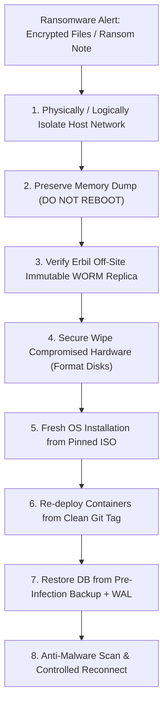

# Incident Runbook: Ransomware Outbreak & Storage Extortion

> **Incident Type**: Malware / Cryptoviral Extortion / Destructive Attack  
> **Severity**: **SEV-1 (Critical Disaster)**  
> **Response SLA**: **Immediate ($\le 5$ Minutes)**

---

## 1. Core Policy: Zero Ransom Payment Mandate

> [!CAUTION]
> **Strict Organization & Humanitarian Directive: NEVER PAY A RANSOM**  
> Under humanitarian principles, international counter-terrorism financing regulations, and mission policy, the organization **will never negotiate or pay a ransom**. Paying ransoms funds criminal enterprises, violates international law, and provides zero guarantee of data restoration.  
> Business continuity relies exclusively on our **air-gapped, immutable WORM backups**.

---

## 2. Immediate Containment Procedure (Execute Immediately)



### Step 2.1: Immediate Network Severance

Prevent the malware from traversing lateral networks to secondary storage or field offices:

```bash
# Drop all network interfaces immediately (except loopback)
sudo ip link set eth0 down
sudo ip link set eth1 down
```

If access is via hypervisor console or physical server, disconnect the physical Ethernet cables immediately.

### Step 2.2: Memory Capture (Do Not Reboot)

Do **NOT** reboot or power off the machine immediately. Encryption keys may reside in volatile RAM:

```bash
# If console is still responsive, create a volatile memory capture
sudo dd if=/dev/mem of=/mnt/usb_isolated/ram_capture.raw bs=1M count=4096 || true
```

---

## 3. Verify Offline Immutable Backups

The primary defense against ransomware is the **secondary sovereign storage cluster in Erbil**, which is configured with **S3 Object Lock in Compliance Mode** and strict write-once-read-many (WORM) controls.

1. Connect to the Erbil backup node via an out-of-band, air-gapped terminal.
2. Confirm the immutable backup status:
   ```bash
   # Verify that base backup and WAL archives are locked and uncorrupted
   mc retention info erbil-backup/humanity-wal/
   # Must return: Mode: Compliance, RetainUntilDate: [Future Date]
   ```
3. Calculate and verify SHA-256 checksums of the pre-infection base backup archive.

---

## 4. Hardware Sanitization & Rebuilding

Never attempt to "clean" a system infected with ransomware. The operating environment must be rebuilt from bare metal.

### Step 4.1: Secure Storage Sanitization

Execute a cryptographic wipe of all NVMe/SATA drives:

```bash
# Boot into air-gapped live recovery media
blkdiscard -f /dev/nvme0n1
# Or secure ATA erase
hdparm --user-master u --security-set-pass Eins /dev/sda
hdparm --user-master u --security-erase Eins /dev/sda
```

### Step 4.2: Operating System Re-installation

1. Re-install Ubuntu 24.04.1 LTS from a verified, SHA-256 validated installer media.
2. Apply full LUKS2 disk encryption with a newly generated passphrase stored in the Mission safe.
3. Install pinned Docker Engine 27.3.1.

### Step 4.3: Platform Manifest Re-deployment

1. Clone the platform repository directly from the verified Git remote:
   ```bash
   git clone -b main https://github.com/humanity-mission/platform.git /srv/humanity-platform
   cd /srv/humanity-platform
   git verify-tag v1.0.0
   git checkout tags/v1.0.0
   ```
2. Re-pull container images from trusted container registries.

### Step 4.4: Database Restoration from Immutable WORM Archive

1. Fetch the pre-infection base backup from the Erbil immutable storage:
   ```bash
   tar -xzf /mnt/erbil_worm/base_backup_20261113.tar.gz -C /srv/humanity-platform/data/postgres/
   ```
2. Replay Write-Ahead Logs up to the timestamp immediately preceding the malware execution:
   ```ini
   # In postgresql.conf
   restore_command = 'gunzip < /mnt/erbil_worm/wal_archive/%f.gz > %p'
   recovery_target_time = '2026-11-13 14:00:00 UTC'
   recovery_target_action = 'promote'
   ```
3. Launch PostgreSQL in recovery mode and verify cluster health.

---

## 5. Post-Recovery Hardening & Reporting

1. **Vulnerability Root Cause Analysis**: Identify infection vector (e.g., exposed RDP, phished administrative credentials, unpatched hypervisor).
2. **Credential Rotation**: Rotate every system secret, database password, and SSH key across the entire mission infrastructure.
3. **Continuous Threat Monitoring**: Deploy Wazuh / OSSEC agent on the rebuilt host with automated alerting for unauthorized file creation.
4. **Mission Briefing**: Present full recovery timeline to the Head of Mission and Country Director.
