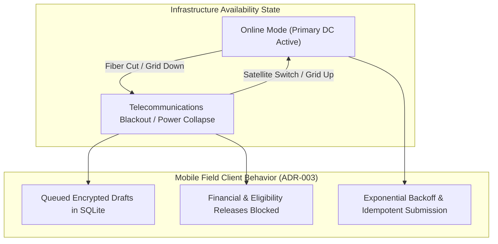
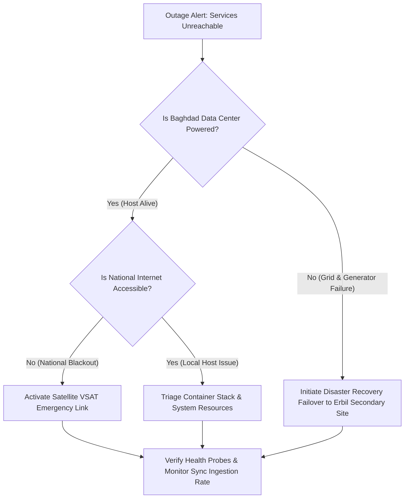

# Incident Runbook: Service Outage, Infrastructure Failure & Telecommunications Blackout

> **Incident Type**: Infrastructure Outage / Grid Power Failure / National Internet Blackout  
> **Severity**: SEV-1 (Total Platform Unavailability) | SEV-2 (Single Region / Network Segment Cut)  
> **Response SLA**: **$\le 15$ Minutes** to failover or offline mode activation

---

## 1. Scenario Context & Iraqi Operational Realities

Humanitarian operations in Iraq frequently experience telecommunications and infrastructure disruptions:

- **National Internet Blackouts**: Periodic government-mandated internet shutdowns during national baccalaureate examinations or civil unrest.
- **Power Grid Collapse**: Frequent municipal grid load shedding requiring seamless automatic transfer switch (ATS) failover to secondary diesel generators and battery UPS arrays.
- **Physical Fiber Cuts**: Accidental cuts to trans-Iraq backbone fiber routes.

---

## 2. Inherent Resilience Architecture

The platform was intentionally engineered with dual operational modes to survive severe infrastructure disruption:



1. **Client-Side Autonomous Operation**: Under ADR-003, mobile field workers can continue creating beneficiary records, conducting vulnerability assessments, and recording visit notes without internet access.
2. **Strict Safety Gates Preserved**: Offline financial disbursement and eligibility approval remain physically and cryptographically prohibited; field workers cannot execute irreversible actions while severed from the ledger.
3. **Idempotent Queue Replay**: Upon network restoration, client mutations are safely processed in strict chronological sequence using unique idempotency keys.

---

## 3. Immediate Outage Triage Procedure



### Step 3.1: Power & Host Verification

Check host accessibility via Out-of-Band Management (IPMI / iDRAC) or local field office console:

- If host is unpowered: Verify Automatic Transfer Switch (ATS) to secondary diesel generator.
- If primary site is completely compromised: Initiate **Failover to Erbil Secondary Node** (see Section 4).

### Step 3.2: Telecommunications & ISP Blackout Handling

If the host is healthy but public internet is down nationwide:

1. **Field Staff Advisory**: Broadcast secure radio announcement instructing field teams to operate in **Offline Mode**.
2. **VSAT Link Activation**:
   - The mission data center is equipped with a licensed private C-band/Ku-band VSAT satellite terminal.
   - Switch Traefik uplink gateway to the VSAT satellite interface:
     ```bash
     sudo ip route change default via 192.168.100.1 dev eth2
     ```
3. **Bandwidth Optimization**: Traefik automatically throttles static asset caching and prioritizes PostgREST API and sync endpoints over media downloads.

### Step 3.3: Container Crash & Service Recovery

If the outage is due to host-level software failure:

1. Connect via SSH/console:
   ```bash
   cd /srv/humanity-platform
   docker compose -f infra/docker-compose.staging.yml ps
   ```
2. Inspect logs of failing containers:
   ```bash
   docker compose -f infra/docker-compose.staging.yml logs --tail=100 supabase-db
   ```
3. Check disk space:
   ```bash
   df -h /var/lib/docker
   # If disk is full, clear old Docker build caches and rotated logs:
   docker system prune -f --volumes=false
   ```
4. Restart services with strict health check dependencies:
   ```bash
   docker compose -f infra/docker-compose.staging.yml up -d
   ```

---

## 4. Secondary Site Failover (Erbil Disaster Recovery)

If the Baghdad primary data center suffers catastrophic failure (e.g. fire, physical destruction, prolonged blackout exceeding 48 hours):

1. **Promote Erbil Secondary Database Cluster**:
   ```bash
   ssh -i /path/to/ops_key ops@erbil-db.humanity.internal.iq \
     "docker exec -i supabase-db psql -U postgres -d postgres -c 'SELECT pg_promote();'"
   ```
2. **Update Mission DNS Records**:
   Switch `app.humanity.internal.iq` and `api.humanity.internal.iq` DNS records to point to the Erbil Traefik gateway IP (`10.20.0.10`).
3. **Verify API Endpoints**:
   ```bash
   curl -kfsS https://app.humanity.internal.iq/api/health
   ```
4. **Notify Operations**: Inform field teams that central sync services are online on the secondary cluster.

---

## 5. Post-Restoration Sync Ingestion & Throttling

When connectivity returns after prolonged outage, hundreds of mobile field clients will attempt to synchronize queued drafts simultaneously:

1. **Activate Ingress Rate Limiting**:
   Traefik dynamic configuration automatically enforces connection pooling and rate limits (`100 req/min per IP`) to prevent database connection exhaustion.
2. **Monitor Database Connection Pool**:
   ```sql
   SELECT count(*), state FROM pg_stat_activity GROUP BY state;
   ```
3. **Audit Ingested Mutations**:
   Verify that offline drafts sync cleanly without unhandled conflicts:
   ```sql
   SELECT count(*) FROM sync_mutations WHERE status = 'conflict';
   ```
4. **Incident Review**: Deliver outage duration and transaction reconciliation report to the Country Director within 24 hours.
