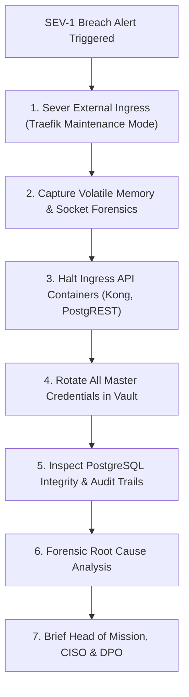

# Incident Runbook: Suspected Platform Breach & Infrastructure Intrusion

> **Incident Type**: Cyber Attack / System Intrusion / RLS Bypass / Database Penetration  
> **Severity**: **SEV-1 (Critical)**  
> **Response SLA**: **Immediate ($\le 5$ Minutes)**

---

## 1. Detection Signals & Breach Indicators

A security breach is suspected upon observation of any of the following:

- Web Application Firewall (WAF) or Traefik alerts reporting SQL injection, directory traversal, or token forgery attacks.
- Sudden, abnormal volume of PostgREST requests from unknown IP addresses attempting bulk entity queries.
- Host-level intrusion detection alerts (e.g., unauthorized sudo elevation, modified binary checksums, unexpected listening sockets).
- PostgreSQL error logs reporting unauthorized connection attempts from outside the internal Docker bridge network (`db-net`).
- Unauthorized creation of superuser roles or changes to Row-Level Security policies.

---

## 2. Emergency Containment Procedure (Immediate Actions)



### Step 2.1: Sever External Ingress (Network Isolation)

Immediately cut off external traffic while preserving internal bastion management:

```bash
# Enable Traefik Emergency Blackhole Middleware
sed -i 's/service: web-service/service: blackhole-service/g' /srv/humanity-platform/infra/config/traefik_dynamic.yml
```

Alternatively, block public HTTP/HTTPS ports at the host firewall level:

```bash
sudo ufw insert 1 deny 80/tcp
sudo ufw insert 1 deny 443/tcp
```

### Step 2.2: Capture Volatile Forensic Evidence

Before stopping containers or rebooting, capture volatile system state for forensic investigation:

```bash
export FORENSIC_DIR="/srv/humanity-platform/forensics/$(date +%Y%m%d_%H%M%S)"
mkdir -p "${FORENSIC_DIR}"

# 1. Capture active network connections and sockets
ss -tulpn > "${FORENSIC_DIR}/network_sockets.txt"
netstat -anp > "${FORENSIC_DIR}/active_connections.txt"

# 2. Capture running process list
ps auxf > "${FORENSIC_DIR}/processes.txt"

# 3. Capture active Docker container states
docker ps --all > "${FORENSIC_DIR}/docker_containers.txt"

# 4. Dump current PostgreSQL active queries
docker compose -f infra/docker-compose.staging.yml exec -T supabase-db \
  psql -U postgres -d postgres -c "SELECT pid, usename, client_addr, state, query FROM pg_stat_activity;" > "${FORENSIC_DIR}/pg_active_queries.txt"
```

### Step 2.3: Halt Ingress API Containers

Stop the API gateway and PostgREST engines to terminate any established sessions:

```bash
docker compose -f infra/docker-compose.staging.yml stop web kong postgrest gotrue
```

---

## 3. Cryptographic Key Invalidation & Credential Rotation

Assume all runtime credentials may have been exfiltrated:

1. **Rotate PostgreSQL Authenticator Password**:
   ```bash
   NEW_PASS=$(openssl rand -base64 32)
   docker compose -f infra/docker-compose.staging.yml exec -T supabase-db \
     psql -U postgres -d postgres -c "ALTER USER authenticator WITH PASSWORD '${NEW_PASS}';"
   ```
2. **Invalidate Master JWT Secret**:
   Generate a completely new JWT secret in Vault. This instantly invalidates every web and mobile token in circulation across Iraq.
3. **Rotate MinIO S3 Root Credentials**:
   Regenerate `MINIO_ROOT_PASSWORD` and storage service accounts.
4. **Revoke and Re-issue Host SSH Keys**:
   Flush `~/.ssh/authorized_keys` and require all administrators to generate new Ed25519 keypairs.

---

## 4. Forensic Investigation & Integrity Verification

1. **Verify Database Integrity**:
   Run checksum validation to ensure data blocks have not been tampered with:
   ```bash
   docker compose -f infra/docker-compose.staging.yml exec -T supabase-db \
     psql -U postgres -d postgres -c "SELECT count(*) FROM audit_events;"
   ```
2. **Review Traefik & Reverse Proxy Access Logs**:
   Examine requests with status 200/500 leading up to the incident:
   ```bash
   tail -n 10000 /var/log/traefik/access.log | grep -E "(\.env|config|select|insert|update|delete|exec)"
   ```
3. **Audit Event Log Analysis**:
   Verify whether any unauthorized users elevated privileges or exported tables:
   ```sql
   SELECT * FROM audit_events
   WHERE action IN ('role_assigned', 'report_exported', 'case_deleted')
     AND created_at >= NOW() - INTERVAL '48 hours'
   ORDER BY created_at DESC;
   ```

---

## 5. Recovery & Secure Service Restoration

1. **Patch Identified Vulnerability**: Deploy hardened code or configuration fix via clean Git commit.
2. **Verify Clean Container Images**: Rebuild web and platform images from verified Dockerfiles.
3. **Restore Clean Database State (If Corrupted)**: Execute Point-in-Time-Recovery (PITR) to a known clean timestamp preceding the intrusion.
4. **Re-enable External Ingress**: Remove blackhole routing in Traefik and restore firewall rules.
5. **Mandatory Reporting**: Submit formal Incident Report to CISO, Head of Mission, and Data Protection Officer within 24 hours; file regulatory notice within 72 hours.
