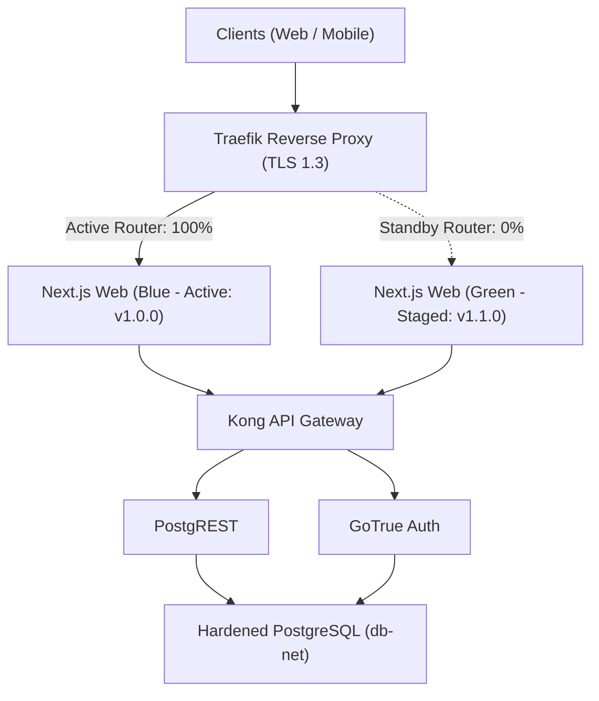

# Deployment Runbook

> **Scope**: Organization-controlled infrastructure (Iraq sovereign hosting or approved dedicated private cloud).  
> **Audience**: Systems Administrators, DevOps Engineers, and Release Coordinators.  
> **Strict Notice**: This runbook describes the deployment process for authorized operators. **Never deploy, open firewall ports, modify DNS, or insert credentials without approved RFC (Request for Change) sign-off.**

---

## 1. Release Classification & Workflow

Every deployment must originate from a signed Git release tag on the repository `main` branch.

| Environment    | Host FQDN (Example)            | Purpose                                                         | Access Restrictions                             |
| :------------- | :----------------------------- | :-------------------------------------------------------------- | :---------------------------------------------- |
| **Staging**    | `staging.humanity.internal.iq` | Pre-production validation, schema migration testing, load tests | VPN only, authorized QA & Ops                   |
| **Production** | `app.humanity.internal.iq`     | Live humanitarian operations                                    | Restricted network, zero direct database access |

---

## 2. Pre-Flight Checklist

Before initiating any deployment, the Release Coordinator must verify and check off all items:

- [ ] **RFC Approval**: Approved change ticket with designated rollback coordinator.
- [ ] **Release Tag**: Verified cryptographic signature on Git release tag (`git tag -v vX.Y.Z`).
- [ ] **CI Verification**: All CI checks passed (lint, typecheck, unit tests, RLS policy tests, license audit).
- [ ] **Secret Availability**: Verified secrets exist in the organization's approved Secret Manager (e.g., HashiCorp Vault, AWS Secrets Manager in-country partition, or self-hosted OpenBao). **Never hardcode secrets.**
- [ ] **Database Pre-Flight**:
  - [ ] Confirmed physical WAL archiving is active (`archive_command` reporting success).
  - [ ] Executed pre-deployment snapshot / pg_dump logical backup:
    ```bash
    ssh ops@staging-db.humanity.internal.iq \
      "docker exec -i supabase-db pg_dump -U postgres -d postgres -F c -b -v -f /var/lib/postgresql/data/backups/pre_deploy_$(date +%Y%m%d_%H%M%S).dump"
    ```
- [ ] **Maintenance Window Notification**: For production, notify operational field teams 24 hours in advance.

---

## 3. Staging Deployment Procedure

### Step 3.1: Host Environment Preparation

Connect to the designated staging deployment host via authorized bastion / VPN:

```bash
ssh -i /path/to/authorized_ops_key ops@staging.humanity.internal.iq
cd /srv/humanity-platform
```

### Step 3.2: Pull Pinned Artifacts

Checkout the exact release tag and verify git status:

```bash
git fetch --tags
git checkout tags/v1.0.0 -b release-v1.0.0
git status # Ensure clean working tree
```

### Step 3.3: Fetch Runtime Secrets from Secret Manager

Inject the staging configuration from the approved Secret Manager into `/srv/humanity-platform/infra/.env.staging` with strict file permissions:

```bash
# Example pulling secrets from HashiCorp Vault CLI:
vault kv get -format=json secret/humanity/staging | jq -r '.data.data | to_entries[] | "\(.key)=\(.value)"' > infra/.env.staging
chmod 600 infra/.env.staging
```

Verify that `.env.staging` contains no missing mandatory variables:

```bash
grep -E "(POSTGRES_PASSWORD|JWT_SECRET|MINIO_ROOT_PASSWORD)=REQUIRED" infra/.env.staging && echo "ERROR: Placeholder detected!" || echo "Secrets verified."
```

### Step 3.4: Build and Pull Container Images

```bash
docker compose -f infra/docker-compose.staging.yml --env-file infra/.env.staging pull
docker compose -f infra/docker-compose.staging.yml --env-file infra/.env.staging build web
```

### Step 3.5: Execute Database Migrations

Migrations are applied sequentially within transactions. Use a disposable runner or containerized psql session connected through the internal `db-net`:

```bash
docker compose -f infra/docker-compose.staging.yml --env-file infra/.env.staging exec -T supabase-db \
  psql -U postgres -d postgres -v ON_ERROR_STOP=1 < supabase/migrations/20261113000001_core_schema.sql

# For automated execution of all pending migrations:
for mig in $(ls supabase/migrations/*.sql | sort); do
  echo "Applying ${mig}..."
  docker compose -f infra/docker-compose.staging.yml --env-file infra/.env.staging exec -T supabase-db \
    psql -U postgres -d postgres -v ON_ERROR_STOP=1 -f - < "${mig}"
done
```

### Step 3.6: Start / Update Services

Bring up the application and platform services in detached mode:

```bash
docker compose -f infra/docker-compose.staging.yml --env-file infra/.env.staging up -d
```

---

## 4. Post-Deployment Verification & Smoke Tests

Execute the automated health and sanity checks immediately after containers are healthy:

### Step 4.1: Container Health Inspection

```bash
docker compose -f infra/docker-compose.staging.yml ps
```

Ensure all services (`traefik`, `web`, `kong`, `gotrue`, `postgrest`, `storage`, `minio`, `supabase-db`) report `(healthy)`.

### Step 4.2: Health Probe Verification

Verify internal and public health endpoints:

```bash
# 1. Reverse Proxy Health
curl -kfsS https://staging.humanity.internal.iq/ping || echo "Traefik ping failed!"

# 2. Next.js Web Application Health
curl -kfsS https://staging.humanity.internal.iq/api/health | jq .

# 3. Kong API Gateway / PostgREST Live Probe
curl -kfsS https://staging.humanity.internal.iq/rest/v1/ -H "apikey: ${ANON_KEY}"

# 4. GoTrue Authentication Health
curl -kfsS https://staging.humanity.internal.iq/auth/v1/health | jq .

# 5. MinIO Storage Health
docker compose -f infra/docker-compose.staging.yml exec -T minio mc ready local
```

### Step 4.3: Functional Smoke Tests

1. **Sign-In Flow**: Authenticate as a staging field officer using the web interface.
2. **Arabic RTL Verification**: Verify the UI loads in Arabic with RTL orientation by default.
3. **Audit Log Generation**: Verify an audit record is created for the login action:
   ```bash
   docker compose -f infra/docker-compose.staging.yml exec -T supabase-db \
     psql -U postgres -d postgres -c "SELECT id, action, actor_id, created_at FROM audit_events ORDER BY created_at DESC LIMIT 5;"
   ```
4. **Maker-Checker Barrier**: Confirm a staff user cannot approve their own submitted financial assistance requests.

---

## 5. Production Zero-Downtime Deployment (Blue/Green Routing)

For production deployments, Traefik routes traffic between two parallel application service sets (`web-blue` and `web-green`):



1. Deploy new code to the inactive target (e.g., `web-green`).
2. Run health probes against `web-green` on its private internal port.
3. Update Traefik dynamic router service target in `/srv/humanity-platform/infra/config/traefik_dynamic.yml` to route to `web-green`.
4. Traefik automatically hot-reloads configuration without dropping in-flight HTTP connections.
5. Monitor error rates for 15 minutes.
6. Once stable, decommission or sleep the legacy target (`web-blue`).

---

## 6. Deployment Sign-Off & Audit Logging

Upon successful verification:

1. Log the deployment event in the operations ledger:
   ```bash
   logger -t humanity-deploy "DEPLOYMENT SUCCESS: Tag v1.0.0 deployed by $(whoami) at $(date -u --iso-8601=seconds)"
   ```
2. Close the change ticket with attached smoke test outputs.
3. Notify the operations monitoring channel.
