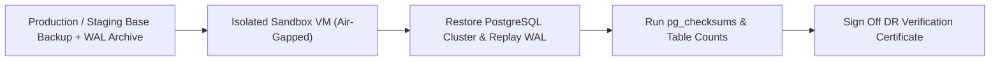
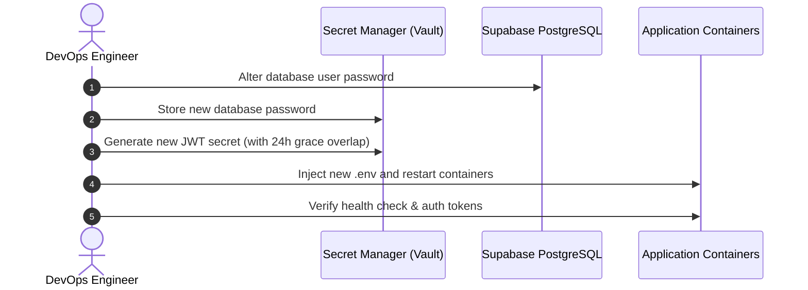

# Maintenance Runbook

> **Scope**: Routine operations, backup validation, patching, secret rotation, and retention compliance.  
> **Audience**: Systems Administrators, Database Administrators, and DevOps Engineers.  
> **Strict Notice**: All maintenance activities on production systems must occur within designated maintenance windows and be logged in the operations ledger.

---

## 1. Routine Maintenance Schedule

| Cadence       | Task                                | Primary Objective                       | SLA / Target                           |
| :------------ | :---------------------------------- | :-------------------------------------- | :------------------------------------- |
| **Daily**     | WAL Archiving & Backup Verification | Verify continuous backup integrity      | Zero archiver lag; RPO $\le 5$ min     |
| **Weekly**    | Disk & Resource Auditing            | Prevent disk saturation on host         | Disk usage $< 75\%$ across all volumes |
| **Monthly**   | Sandbox Restore Rehearsal           | Rehearse full disaster recovery         | RTO $< 2$ hours; data checksum pass    |
| **Quarterly** | Host OS & Docker Patching           | Apply critical security vulnerabilities | Zero CVEs with CVSS $\ge 7.0$          |
| **Quarterly** | Secret Rotation                     | Rotate service credentials & JWT keys   | Zero operational downtime              |
| **Annually**  | Audit Retention & Legal Hold Review | Verify 7-year compliance & legal holds  | Complete compliance audit log          |

---

## 2. Daily Backup & WAL Archiving Verification

### Step 2.1: Check PostgreSQL WAL Archiving Status

Execute from the database host:

```bash
docker compose -f infra/docker-compose.staging.yml exec -T supabase-db \
  psql -U postgres -d postgres -x -c "SELECT archived_count, last_archived_wal, last_archived_time, failed_count, last_failed_wal, last_failed_time FROM pg_stat_archiver;"
```

**Pass Criteria:**

- `failed_count` is `0`.
- `last_archived_time` is within the last 5 minutes.
- If `failed_count > 0`, inspect PostgreSQL logs immediately:
  ```bash
  docker compose -f infra/docker-compose.staging.yml logs --tail=100 supabase-db | grep -i "archive"
  ```

### Step 2.2: Verify Remote Snapshot Sync

Confirm that daily base backups are successfully copied to the sovereign secondary physical storage node:

```bash
ls -lh /var/lib/postgresql/backups/
# Verify today's file exists and size is consistent with prior days:
# -rw-r----- 1 postgres postgres 2.4G Nov 13 02:00 base_backup_20261113.tar.gz
```

---

## 3. Monthly Disaster Recovery Rehearsal (Sandbox Restore)

The organization requires a documented monthly restore rehearsal to prove RTO $< 2$ hours and verify zero data corruption.



### Rehearsal Steps (Executed on Isolated Sandbox Host):

1. **Initialize Clean Workspace**:
   ```bash
   mkdir -p /tmp/dr_rehearsal/data /tmp/dr_rehearsal/wal
   ```
2. **Extract Latest Base Backup**:
   ```bash
   tar -xzf /mnt/backups/base_backup_latest.tar.gz -C /tmp/dr_rehearsal/data/
   ```
3. **Configure Recovery Target to Replay Latest Available WAL**:
   ```bash
   cat <<EOF >> /tmp/dr_rehearsal/data/postgresql.conf
   restore_command = 'cp /mnt/backups/wal_archive/%f %p'
   recovery_target = 'immediate'
   recovery_target_action = 'promote'
   EOF
   touch /tmp/dr_rehearsal/data/recovery.signal
   ```
4. **Launch Sandbox Database Container**:
   ```bash
   docker run --rm -v /tmp/dr_rehearsal/data:/var/lib/postgresql/data -e POSTGRES_PASSWORD=dr_test supabase/postgres:15.8.1.135
   ```
5. **Verify Row Counts & Audit Log Continuity**:
   ```bash
   docker exec -i sandbox-db psql -U postgres -d postgres -c "
     SELECT 'beneficiaries' AS tbl, count(*) FROM beneficiaries
     UNION ALL
     SELECT 'households', count(*) FROM households
     UNION ALL
     SELECT 'audit_events', count(*) FROM audit_events;"
   ```
6. **Log Verification Certificate**:
   Record recovery completion time, total elapsed duration, and operator signature in `docs/operations/dr_records/rehearsal_YYYY_MM.md`.

---

## 4. Operating System & Docker Security Patching

### Host OS Patching (Ubuntu 24.04 LTS)

1. **Schedule Maintenance Window** (e.g., Sunday 02:00–04:00 UTC).
2. **Review Pending Security Updates**:
   ```bash
   sudo apt-get update
   apt list --upgradable | grep -i security
   ```
3. **Apply Security Upgrades**:
   ```bash
   sudo apt-get --only-upgrade install -y linux-image-generic docker-ce docker-compose-plugin
   ```
4. **If Kernel Reboot Required**:
   - Drain active connections via Traefik.
   - Stop application containers gracefully:
     ```bash
     docker compose -f infra/docker-compose.staging.yml down --timeout 30
     ```
   - Reboot host: `sudo reboot`.
   - Bring services back up upon reboot:
     ```bash
     docker compose -f infra/docker-compose.staging.yml up -d
     ```

---

## 5. Database Optimization & Housekeeping

### Step 5.1: Transaction ID Wraparound Monitoring

PostgreSQL requires periodic vacuuming to prevent transaction ID wraparound:

```bash
docker compose -f infra/docker-compose.staging.yml exec -T supabase-db \
  psql -U postgres -d postgres -c "SELECT datname, age(datfrozenxid) FROM pg_database WHERE datname = 'postgres';"
```

_Threshold Alert_: If `age(datfrozenxid) > 1,000,000,000`, run a full vacuum during the next maintenance window.

### Step 5.2: Manual Off-Peak Vacuum & Analyze

During scheduled low-activity periods:

```bash
docker compose -f infra/docker-compose.staging.yml exec -T supabase-db \
  psql -U postgres -d postgres -c "VACUUM (ANALYZE, VERBOSE) beneficiaries, households, cases, assistance_deliveries, audit_events;"
```

### Step 5.3: Index Reindexing (Zero Downtime)

To remove index bloat on high-insert audit and transaction tables without locking writes:

```bash
docker compose -f infra/docker-compose.staging.yml exec -T supabase-db \
  psql -U postgres -d postgres -c "REINDEX TABLE CONCURRENTLY audit_events;"
```

---

## 6. Secret Rotation Procedure

All credentials must be rotated at least every 90 days or immediately following any staff departure with administrative access.



### Step 6.1: Database Password Rotation

1. Generate high-entropy password (min 32 characters, base64/hex):
   ```bash
   NEW_DB_PASS=$(openssl rand -base64 32)
   ```
2. Update PostgreSQL user password:
   ```bash
   docker compose -f infra/docker-compose.staging.yml exec -T supabase-db \
     psql -U postgres -d postgres -c "ALTER USER authenticator WITH PASSWORD '${NEW_DB_PASS}';"
   ```
3. Update `POSTGRES_PASSWORD` and `AUTHENTICATOR_PASSWORD` in the Secret Manager.
4. Restart application containers (`gotrue`, `postgrest`, `storage`) to pick up the updated secret.

### Step 6.2: JWT Secret Rotation (Mobile Session Protection)

To avoid immediately disconnecting field staff in areas with intermittent connectivity:

1. GoTrue supports multiple verification keys during transition. Add the previous key as `GOTRUE_JWT_SECRET_FALLBACK`.
2. Set the newly generated key as `GOTRUE_JWT_SECRET`.
3. Newly issued tokens use the new secret; existing active tokens remain valid until expiration (max 24 hours).
4. After 24 hours, remove `GOTRUE_JWT_SECRET_FALLBACK`.

---

## 7. Legal Hold & Audit Retention Compliance

Humanitarian accountability standards require a **strict 7-year immutable audit retention policy**, while adhering to data minimization for operational records.

### Retention Rules:

1. **Audit Logs (`audit_events`)**:
   - Must be retained for a minimum of 7 years.
   - Deletion or truncation of `audit_events` is cryptographically and procedurally prohibited.
   - The PostgreSQL user role granted to PostgREST (`anon`, `authenticated`) has zero `DELETE` or `UPDATE` privileges on `audit_events`.
2. **Legal Hold Enforcement**:
   - Cases or beneficiary records flagged with `legal_hold = true` are immune to standard retention lifecycle archival.
   - To review active legal holds:
     ```bash
     docker compose -f infra/docker-compose.staging.yml exec -T supabase-db \
       psql -U postgres -d postgres -c "SELECT id, case_number, legal_hold, created_at FROM cases WHERE legal_hold = true;"
     ```
3. **Application Log Rotation**:
   - Server diagnostic logs (PostgreSQL error logs, Traefik access logs) are rotated every 24 hours and retained for 90 days:
     ```bash
     logrotate -f /etc/logrotate.d/humanity-docker
     ```
