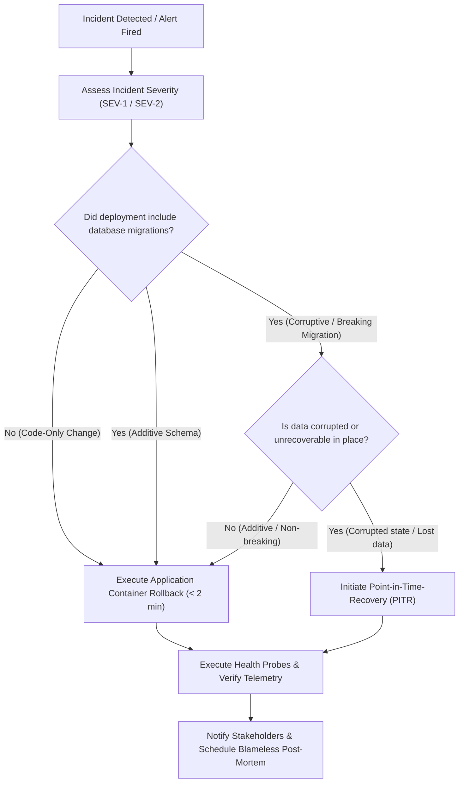

# Rollback Runbook

> **Scope**: Organization-controlled infrastructure (Iraq sovereign hosting or approved dedicated private cloud).  
> **Audience**: On-Call Engineers, Site Reliability Engineers, and Incident Commanders.  
> **Strict Notice**: Rollback actions must be coordinated through the designated Incident Commander. Never attempt uncoordinated manual schema edits on live databases.

---

## 1. Rollback Trigger Criteria & Severity Levels

Rollback must be initiated immediately upon confirmation of any of the following triggers:

| Severity             | Definition                                              | Examples                                                                                  | Action Timeframe                             |
| :------------------- | :------------------------------------------------------ | :---------------------------------------------------------------------------------------- | :------------------------------------------- |
| **SEV-1 (Critical)** | Core security failure, data corruption, or total outage | RLS bypass, unauthorized data disclosure, database corruption, health check down >3 min   | **Immediate** (< 5 minutes)                  |
| **SEV-2 (High)**     | Major workflow broken; no viable workaround             | Financial disbursement blocked, offline sync failing systematically, maker-checker broken | **< 30 minutes** (if no immediate hotfix)    |
| **SEV-3 (Moderate)** | Non-critical workflow degraded; workaround available    | Minor localized UI glitch, non-blocking report generation slow                            | **Fix-forward preferred**; rollback optional |

### Automated Incident Triggers

- **Error Rate**: Traefik or Kong reporting HTTP 5xx responses $> 2\%$ across any 5-minute window.
- **Health Checks**: `/api/health` or PostgREST `/live` failing for 3 consecutive 15-second checks.
- **Database Starvation**: Active PostgreSQL connections $> 90\%$ of `max_connections` (180/200) with sustained connection queueing.

---

## 2. Immediate Decision Flowchart



---

## 3. Application Rollback Procedure (Zero Database Impact)

When the failure is isolated to application logic, web frontend, or edge routing, roll back the container stack without altering the database.

### Step 3.1: Instant Traefik Route Switch (Blue/Green)

If Blue/Green deployment was used:

1. Open `/srv/humanity-platform/infra/config/traefik_dynamic.yml`.
2. Revert the active router service from `web-green` back to `web-blue`:
   ```yaml
   http:
     routers:
       web-router:
         service: web-blue-service # Reverted to previous stable target
   ```
3. Traefik automatically hot-reloads the route within seconds.

### Step 3.2: Container Tag Rollback (Standard Deployment)

If standard deployment was used:

1. Revert repository to the previous stable release tag:
   ```bash
   cd /srv/humanity-platform
   git checkout tags/v<PREVIOUS_STABLE_TAG>
   ```
2. Re-create the web container using the previous image tag:
   ```bash
   docker compose -f infra/docker-compose.staging.yml --env-file infra/.env.staging up -d --no-deps web
   ```
3. Confirm container health:
   ```bash
   docker compose -f infra/docker-compose.staging.yml ps web
   ```

---

## 4. Database Rollback Strategy

> [!CAUTION]
> **Forward-Only Database Philosophy**: Reversing database migrations with manual `DROP COLUMN` or `DROP TABLE` statements can destroy data created by live transactions during the failed window. Only roll back database states when verified strictly necessary.

### Scenario A: Additive Migration Rollback (Preferred)

If the migration added new columns, tables, or indexes without altering existing contracts:

1. **Leave the schema additions in place.** The previous version of the application code ($N-1$) will simply ignore the new columns.
2. Roll back the application containers as described in Section 3.
3. Prepare a forward-fix migration for the next release cycle.

---

### Scenario B: Point-in-Time Recovery (PITR)

If a destructive migration occurred or table data was corrupted:

#### Step 4.1: Isolate the Platform (Maintenance Mode)

Enable the Traefik maintenance middleware to block external ingress:

```bash
# Update traefik_dynamic.yml to point the router to the maintenance page
sed -i 's/service: web-service/service: maintenance-service/g' /srv/humanity-platform/infra/config/traefik_dynamic.yml
```

#### Step 4.2: Stop API and Application Services

Prevent any further writes to PostgreSQL:

```bash
docker compose -f infra/docker-compose.staging.yml stop web kong gotrue postgrest storage
```

#### Step 4.3: Determine the Recovery Target Time

Identify the exact UTC timestamp immediately preceding the deployment migration:

```bash
# Check the deployment log timestamp:
grep "Applying" /srv/humanity-platform/logs/deploy.log | head -n 1
# Example target time: '2026-11-13 18:45:00 UTC'
```

#### Step 4.4: Execute PostgreSQL PITR

1. Stop PostgreSQL:
   ```bash
   docker compose -f infra/docker-compose.staging.yml stop supabase-db
   ```
2. Restore the pre-deployment base backup into the PostgreSQL data directory:
   ```bash
   rm -rf /var/lib/postgresql/data/*
   tar -xzf /var/lib/postgresql/backups/base_backup_latest.tar.gz -C /var/lib/postgresql/data/
   ```
3. Configure recovery target in `/var/lib/postgresql/data/postgresql.conf`:
   ```ini
   restore_command = 'cp /var/lib/postgresql/wal_archive/%f %p'
   recovery_target_time = '2026-11-13 18:45:00 UTC'
   recovery_target_action = 'promote'
   ```
4. Signal recovery mode:
   ```bash
   touch /var/lib/postgresql/data/recovery.signal
   ```
5. Start PostgreSQL and monitor recovery logs:
   ```bash
   docker compose -f infra/docker-compose.staging.yml start supabase-db
   docker compose -f infra/docker-compose.staging.yml logs -f supabase-db
   ```
6. Verify recovery completed and database was promoted to primary:
   ```bash
   docker compose -f infra/docker-compose.staging.yml exec supabase-db \
     psql -U postgres -d postgres -c "SELECT pg_is_in_recovery();"
   # Must return 'f' (false)
   ```

#### Step 4.5: Resume Services

Bring the application and gateway stack back online:

```bash
docker compose -f infra/docker-compose.staging.yml start gotrue postgrest storage kong web
# Disable maintenance mode in Traefik
sed -i 's/service: maintenance-service/service: web-service/g' /srv/humanity-platform/infra/config/traefik_dynamic.yml
```

---

## 5. Post-Rollback Validation Checklist

After executing a rollback, verify:

- [ ] Reverse proxy is routing to the stable release: `curl -kfsS https://staging.humanity.internal.iq/api/health`
- [ ] PostgREST API responds with expected schema: `curl -kfsS https://staging.humanity.internal.iq/rest/v1/`
- [ ] Authentication works for web and mobile clients.
- [ ] Audit logging is actively capturing post-rollback events.
- [ ] 5xx error rate on Traefik dashboard has dropped to $0\%$.

---

## 6. Incident Communication & Retrospective

1. **Incident Status Update**: Send notification to leadership and field directors:
   > _"Platform rollback to version vX.Y.Z completed successfully at [TIMESTAMP]. System is fully operational. No data loss detected."_
2. **Post-Mortem Requirement**: Schedule a blameless post-mortem within 48 hours.
3. **Artifact Retention**: Archive deployment and incident logs in `/srv/humanity-platform/logs/incidents/` for audit review.
