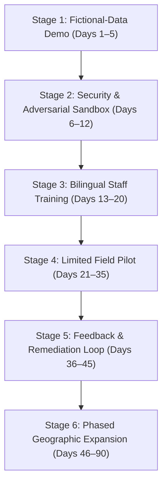
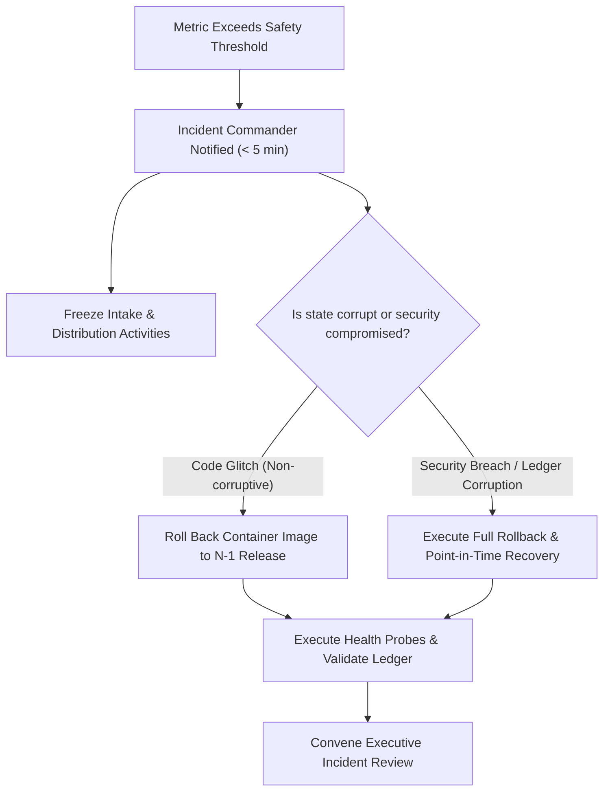
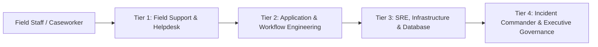

# Staged Rollout, Pilot & Support Operations Plan

> **Program**: Humanitarian Operations Management Platform (Iraq Mission)  
> **Classification**: Operational Strategy & Field Governance  
> **Mandate**: This document defines the six-stage rollout framework, limited pilot parameters, rollback trigger criteria, and four-tier support structure for platform deployment.

---

## 1. Rollout Principles & Governance

The platform handles highly sensitive humanitarian records across 18 Iraqi governorates. The rollout strategy adheres strictly to four core principles:

1. **Humanitarian "Do No Harm"**: At no point may deployment activities disrupt ongoing life-saving aid distributions or compromise the physical safety of beneficiaries.
2. **Zero "Big-Bang" Deployments**: Rollout progresses through strict, evidence-verified stages from synthetic sandbox demonstrations to localized pilot deployments and gradual geographic expansion.
3. **Sovereign Infrastructure Gate**: Live data may only be processed once physical hosting in organization-controlled Iraqi data centers (Baghdad/Erbil) has received formal security sign-off.
4. **Immediate Rollback Authority**: The Incident Commander and Field Operations Lead hold absolute authority to halt or revert any rollout stage upon breach of defined threshold criteria.

---

## 2. Six-Stage Rollout Lifecycle

### Stage 1: Fictional-Data Executive & Donor Demonstration (Days 1–5)

- **Target Audience**: Head of Mission, Country Director, UN Cluster Coordinators (UNHCR, WFP, OCHA), Donor Representatives.
- **Environment**: Isolated Demo Sandbox (`demo.humanity.internal.iq`).
- **Data Scope**: **100% Synthetic Data**. 250 fictional Iraqi beneficiary profiles, 100 sample cases across all 8 humanitarian programmes, synthetic double-entry ledger entries.
- **Objectives**: Validate business alignment, demonstrate Arabic RTL interface fidelity, demonstrate maker-checker dual authorization, and prove that no live or identifiable data is exposed.
- **Stage Exit Gate**: Formal sign-off on product alignment from Country Director and Field Operations Director.

### Stage 2: Security & Adversarial Sandbox Verification (Days 6–12)

- **Target Audience**: Independent Penetration Testing Team, Internal Red Team, Security Compliance Auditors.
- **Environment**: Isolated Hardened Staging Stack (`security-test.humanity.internal.iq`).
- **Data Scope**: Anonymized synthetic data with embedded boundary-testing edge cases.
- **Objectives**:
  - Verify complete Row-Level Security (RLS) tenant and governorate isolation.
  - Stress test offline mobile sync tampering, replay attacks, and duplicate mutation injection.
  - Attempt privilege escalation, self-approval bypasses in financial workflows, and directory traversal on storage buckets.
  - Verify zero privileged `service_role` keys present in web or mobile client bundles.
- **Stage Exit Gate**: Clean penetration test report with zero critical or high vulnerabilities (CVSS $\ge 7.0$) signed by CISO.

### Stage 3: Bilingual Staff Training & Competency Verification (Days 13–20)

- **Target Audience**: 120 staff members across all field offices (Caseworkers, Supervisors, Finance Makers, Finance Checkers, Intake Officers, Auditors).
- **Environment**: Dedicated Training Sandbox (`training.humanity.internal.iq`) with reset-to-seed capability every 24 hours.
- **Curriculum Modules**:
  1. _Module A: Identity & Informed Consent_: Capturing explicit consent, mandatory biometric/national ID verification, and duplicate check adjudication.
  2. _Module B: Case Lifecycle & Safeguarding_: Managing vulnerability flags, case reassignment, and safe case closure.
  3. _Module C: Assistance & Financial Segregation_: Dual-authorization maker-checker workflow, delivery verification, and compensating reversals (ADR-004).
  4. _Module D: Mobile Field Operations_: Offline draft creation, SQLite encryption, field connectivity loss, and manual conflict resolution.
- **Stage Exit Gate**: 100% of participating staff achieve $\ge 90\%$ passing grade on role-specific practical competency assessments.

### Stage 4: Limited Field Pilot (Days 21–35)

- **Geographic Scope**: Restricted to a single sub-district (e.g., Erbil District or Baghdad Al-Karkh).
- **Staff Cohort**: Exactly 2 field teams (4 caseworkers, 1 supervisor, 1 finance maker, 1 finance checker).
- **Beneficiary Quota**: Strictly capped at **50 to 100 approved beneficiaries**.
- **Programme Sectors**: Restricted to **EMG (Emergency Assistance)** and **FOD (Food Security)**.
- **Operational Guardrails**:
  - Real-time monitoring of all PostgREST API requests and database queries.
  - Daily reconciliation of financial ledger balances against bank/cash transfer confirmation receipts.
  - Zero cross-governorate data access permitted.
- **Stage Exit Gate**: 14 consecutive days of zero SEV-1/SEV-2 incidents, 100% financial reconciliation parity, and DPO verification.

### Stage 5: Structured Feedback & Remediation Loop (Days 36–45)

- **Process**: Daily structured debriefs with pilot caseworkers and finance staff.
- **Key Metrics Captured**:
  - Time-to-complete intake per beneficiary (target: $\le 10$ minutes).
  - Usability issues in Arabic RTL layouts on mobile screens under direct sunlight.
  - Mobile sync latency and battery consumption on low-end Android field devices.
  - Number of duplicate review false positives.
- **Engineering Sprint**: Deploy non-breaking UI/UX refinements, label adjustments, and performance optimizations.
- **Stage Exit Gate**: Sign-off from pilot team leads that all identified usability blockers have been resolved.

### Stage 6: Phased Geographic Expansion (Days 46–90)

Rollout across Iraq proceeds in four disciplined regional tranches:

| Tranche      | Governorates Included       | Target Field Staff | Prerequisite Verification Gate                                   |
| :----------- | :-------------------------- | :----------------- | :--------------------------------------------------------------- |
| **Phase 6A** | Ninawa (Mosul), Erbil       | 35 Staff           | Local hosting connectivity & VSAT satellite backup verified.     |
| **Phase 6B** | Baghdad, Anbar (Ramadi)     | 40 Staff           | Maker-checker approval limits configured for regional managers.  |
| **Phase 6C** | Basra, Dhi Qar, Maysan      | 25 Staff           | High-temperature ruggedized hardware deployed to field teams.    |
| **Phase 6D** | Kirkuk, Sulaymaniyah, Duhok | 20 Staff           | Kurdish (Sorani/Kurmanji) localization advisory notes published. |

---

## 3. Quantitative Rollback Trigger Criteria

A stage rollback or complete operational freeze must be initiated immediately upon confirmation of any of the following quantitative thresholds:

| Metric / Symptom               | Threshold for Action                                                          | Trigger Action                                                                      | SLA           |
| :----------------------------- | :---------------------------------------------------------------------------- | :---------------------------------------------------------------------------------- | :------------ |
| **API Error Rate**             | HTTP 5xx responses $> 2\%$ over a 5-minute rolling window.                    | Roll back web/api container images to previous release ($N-1$).                     | $\le 10$ min  |
| **Financial Discrepancy**      | Unreconciled difference $> 0.00$ IQD between ledger debits and credits.       | Immediate freeze of all financial approval workflows. Initiate audit investigation. | Immediate     |
| **Maker-Checker Bypass**       | Any recorded transaction where `maker_id == checker_id`.                      | Immediate emergency suspension of financial service. Escalate to SEV-1.             | $\le 5$ min   |
| **Offline Sync Conflicts**     | Conflict rate $> 5\%$ of total synchronized mutations.                        | Pause mobile auto-sync; enforce human supervisor review on all queued drafts.       | $\le 30$ min  |
| **Unauthorized Data Exposure** | RLS policy failure or cross-governorate record access logged in `audit_logs`. | Enable Traefik blackhole maintenance mode. Rotate JWT secret across all clients.    | $\le 5$ min   |
| **Mobile Keystore Failure**    | Cryptographic key loss or decryption failure on field device $> 2$ instances. | Halt field device deployments. Mandate re-keying and MDM verification.              | $\le 2$ hours |

---

## 4. Four-Tier Support Architecture & Ownership

The organization maintains a 24/7 four-tier technical and operational support structure:

### Tier 1: Field Operations Helpdesk

- **Primary Scope**: First-line user support, password resets, mobile device enrollment, hardware replacement, UI navigation assistance.
- **Staffing**: Bilingual (Arabic/English) support agents located in Baghdad and Erbil field offices.
- **Contact**: Extension `4001` / WhatsApp Field Desk / Radio Channel 2.
- **Named Owner**: **Ahmed Al-Bayati** (Field Support Lead).
- **Target Response SLA**: $\le 15$ minutes; Resolution: $\le 2$ hours.

### Tier 2: Application & Workflow Engineering

- **Primary Scope**: Bug triage, workflow state transitions, duplicate review edge cases, report generation errors, sync conflict adjudication.
- **Staffing**: Senior Software Engineers and Application Administrators.
- **Contact**: `tier2-support@humanity.internal.iq` / Jira Service Desk.
- **Named Owner**: **Noor Al-Hashemi** (Platform Application Lead).
- **Target Response SLA**: $\le 30$ minutes; Resolution: $\le 4$ hours.

### Tier 3: SRE, Infrastructure & Database Operations

- **Primary Scope**: Server health, container orchestration, Traefik proxy, PostgreSQL performance, WAL archiving, MinIO storage, backup integrity.
- **Staffing**: On-call DevOps and Database Administrators.
- **Contact**: PagerDuty Escalation / `ops-oncall@humanity.internal.iq`.
- **Named Owner**: **Tariq Al-Jubouri** (Senior SRE / DBA Lead).
- **Target Response SLA**: $\le 15$ minutes (24/7); Resolution: $\le 2$ hours.

### Tier 4: Incident Commander & Executive Governance

- **Primary Scope**: SEV-1 security breaches, data protection impact assessments, disaster recovery invocation, regulatory notifications.
- **Members**: Chief Information Security Officer, Data Protection Officer, Head of Mission, Legal Counsel.
- **Named Leads**:
  - **Dr. Zaid Al-Rawi** (Chief Information Security Officer)
  - **Fatima Al-Khafaji** (Humanitarian Data Protection Officer)
- **Target SLA**: Convene Incident Bridge within $\le 15$ minutes of SEV-1 declaration.
