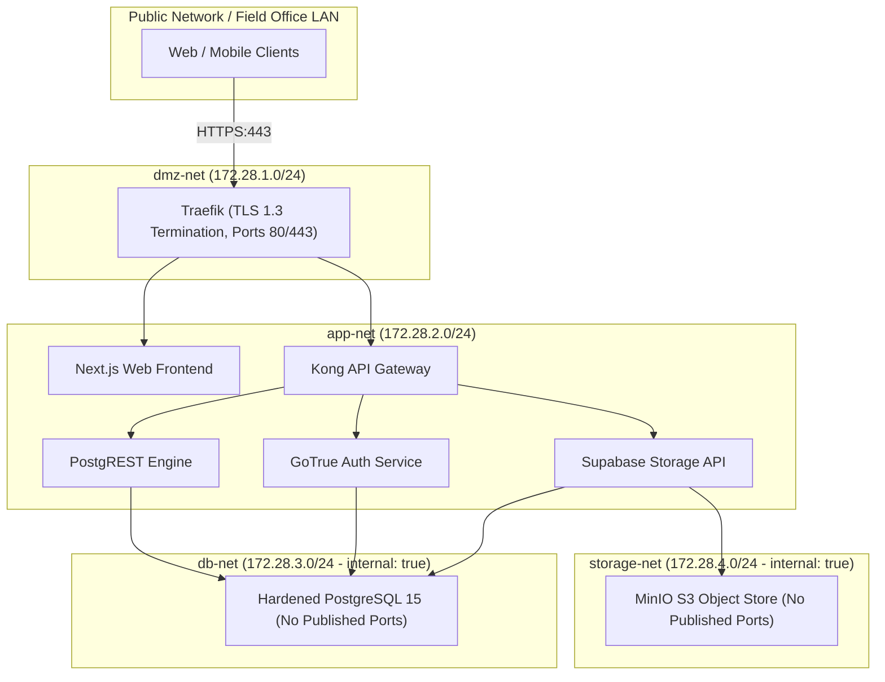

# Infrastructure Manifests & Staging Environment

This directory contains container orchestration, reverse proxy configurations, and database hardening parameters for self-hosted sovereign deployments.

> [!WARNING]
> **STRICT SECURITY REQUIREMENT: ZERO COMMITTED SECRETS**  
> Never commit actual passwords, private certificates, JWT secrets, or production environment variables into this repository. All environment variables in compose manifests must be dynamically provided at runtime via an approved secret manager (e.g., HashiCorp Vault or self-hosted OpenBao).

---

## Directory Structure

```
infra/
├── .env.staging.example       # Non-secret template for staging environment variables
├── docker-compose.staging.yml # Self-hosted staging stack specification (Traefik, Next.js, Kong, PostgREST, GoTrue, Storage, MinIO, PostgreSQL)
├── config/
│   ├── pg_hba.conf            # Hardened PostgreSQL host-based authentication rules
│   ├── postgres.conf          # Hardened PostgreSQL 15 parameters (TLS 1.3, SCRAM-SHA-256, WAL archiving)
│   └── traefik_dynamic.yml    # Reverse proxy dynamic routes, TLS 1.3 ciphers, and rate limiting
└── README.md                  # This file
```

---

## Network Isolation Architecture

The Docker Compose configuration enforces strict multi-tier network zoning:



### Key Security Guardrails:

1. **Zero Database Host Exposure**: Neither PostgreSQL (`5432`) nor MinIO (`9000`) binds to any host interface (`0.0.0.0` or `127.0.0.1`). They are connected exclusively to `internal: true` bridge networks accessible only by the API containers.
2. **Encrypted Transport**: Public traffic terminates at Traefik with TLS 1.3; internal database connections require SSL with SCRAM-SHA-256 authentication.
3. **Continuous WAL Archiving**: PostgreSQL is configured for continuous Write-Ahead Log archiving (`archive_mode = on`) to provide sub-5-minute RPO.

---

## Staging Startup Reference

For full execution details, refer to the [Deployment Runbook](file:///c:/Users/MSI/Desktop/MANAGE/docs/operations/runbooks/deployment.md).

```bash
# 1. Populate secrets from Vault into a non-tracked .env file
vault kv get -format=json secret/humanity/staging | ... > infra/.env.staging
chmod 600 infra/.env.staging

# 2. Start the stack
docker compose -f infra/docker-compose.staging.yml --env-file infra/.env.staging up -d

# 3. Check container status
docker compose -f infra/docker-compose.staging.yml ps
```
